# Current ER Diagram (As-Is System Baseline)

**Document Purpose:** Visual representation of the active PostgreSQL database model (`rms_db`) prior to redesign.  
**Integrity Rule:** Strictly visualizes verified existing relationships. Physical database-enforced constraints are explicitly distinguished from loose application-level conventions.

---

## 1. Verified As-Is Entity Relationship Diagram

```mermaid
erDiagram
    %% PHYSICAL DATABASE FOREIGN KEYS (Only 2 in live PostgreSQL database)
    ROOMS ||--o{ ADMISSIONS : "room_no (ENFORCED FK: fk6j2g2tty4ukvdgsqwe2ymjmtq)"
    TENANTS ||--o{ ADMISSIONS : "tenant_uid (ENFORCED FK: fkie3wy2hxh07dq0a28nb0u3g62)"

    %% LOGICAL APPLICATION-LEVEL CONVENTIONS (NO physical DB constraints)
    PROPERTIES ||--o{ ROOMS : "property_id (logical scalar - NO DB FK)"
    PROPERTIES ||--o{ TENANTS : "property_id (logical scalar - NO DB FK)"
    PROPERTIES ||--o{ ADMISSIONS : "property_id (logical scalar - NO DB FK)"
    PROPERTIES ||--o{ VACATE_REQUESTS : "property_id (logical scalar - NO DB FK)"
    PROPERTIES ||--o{ INVOICES : "property_id (logical scalar - NO DB FK)"
    PROPERTIES ||--o{ PAYMENTS : "property_id (logical scalar - NO DB FK)"
    PROPERTIES ||--o{ LEDGER_TRANSACTIONS : "property_id (logical scalar - NO DB FK)"
    PROPERTIES ||--o{ PROPERTY_ARCHIVE_SNAPSHOTS : "property_id (logical scalar - NO DB FK)"

    ROOMS ||--o{ TENANTS : "room_no (loose string - NO DB FK)"
    ROOMS ||--o{ VACATE_REQUESTS : "room_no (loose string - NO DB FK)"
    ROOMS ||--o{ INVOICES : "room_no (denormalized string - NO DB FK)"

    TENANTS ||--o{ VACATE_REQUESTS : "tenant_uid (loose string - NO DB FK)"
    TENANTS ||--o{ INVOICES : "tenant_uid (loose string - NO DB FK)"
    TENANTS ||--o{ PAYMENTS : "tenant_uid (loose string - NO DB FK)"
    TENANTS ||--o{ LEDGER_TRANSACTIONS : "tenant_uid (loose string - NO DB FK)"

    INVOICES ||--o{ PAYMENTS : "invoice_id (loose scalar - NO DB FK)"
    INVOICES ||--o{ LEDGER_TRANSACTIONS : "invoice_id (loose scalar - NO DB FK)"
    PAYMENTS ||--o{ LEDGER_TRANSACTIONS : "payment_id (loose scalar - NO DB FK)"

    PROPERTIES {
        bigint id PK "Identity sequence"
        varchar name UK "Unique name"
        varchar code UK "Unique code"
        varchar address
        varchar city
        varchar state
        varchar pincode
        varchar property_type
        int total_floors "Denormalized count"
        int total_rooms "Denormalized count"
        varchar contact_number
        varchar contact_email
        varchar status
        boolean is_deleted "Soft-delete flag"
        timestamp deleted_at
        varchar deleted_by
        varchar deletion_reason
        timestamp ttl_expires_at "30-day grace period"
        bigint archive_snapshot_id
        timestamp created_at
        timestamp updated_at
    }

    PROPERTY_ARCHIVE_SNAPSHOTS {
        bigint id PK "Identity sequence"
        bigint property_id "NO DB FK"
        varchar property_name
        varchar property_code
        varchar archived_by
        varchar deletion_reason
        int ttl_days
        int total_rooms
        int total_residents
        double total_revenue_potential
        double total_advance_held
        text snapshot_json
        timestamp archived_at
    }

    ROOMS {
        varchar room_no PK "Natural String PK"
        varchar floor "Free-text string"
        varchar room_type
        int rent_per_month "Whole INR"
        int occupancy "Configured capacity"
        int current_occupancy "Mutable counter"
        int reserved_capacity "Mutable counter"
        boolean available "Computed flag"
        bigint property_id "NO DB FK"
        varchar vacate_date "Denormalized"
        varchar vacate_status "Denormalized"
        varchar vacating_resident "Denormalized"
    }

    TENANTS {
        varchar uid PK "UUID string PK"
        varchar name
        varchar aadhaar_no UK "Candidate key"
        varchar mobile_number
        varchar tenant_type "Working / Student"
        varchar organization_name
        varchar parent_contact
        varchar room_no "NO DB FK"
        int advance_paid "Whole INR"
        varchar advance_paid_status "PENDING / PAID"
        int standard_rent "Whole INR"
        varchar status "ACTIVE / INACTIVE"
        bigint property_id "NO DB FK"
    }

    ADMISSIONS {
        bigint id PK "Identity sequence"
        varchar admission_number UK "Business key"
        varchar tenant_uid FK "Physical FK -> tenants(uid)"
        varchar room_no FK "Physical FK -> rooms(room_no)"
        bigint property_id "NO DB FK"
        varchar status "PENDING, PAID, CANCELLED, VACATED"
        date enrollment_date
        varchar remarks
        timestamp confirmed_on
        date vacated_on
        timestamp created_at
        timestamp updated_at
    }

    VACATE_REQUESTS {
        bigint id PK "Identity sequence"
        varchar request_id UK "Business key"
        varchar tenant_uid "NO DB FK"
        varchar tenant_name "Denormalized"
        varchar room_no "NO DB FK"
        varchar mobile_number "Denormalized"
        varchar aadhaar_no "Denormalized"
        bigint property_id "NO DB FK"
        date request_date
        date expected_leaving_date
        int notice_days
        double advance_paid "Float precision"
        double maintenance_charge "Float precision"
        double breakage_charge "Float precision"
        double advance_repayable "Float precision"
        varchar status "PENDING, APPROVED, REJECTED, COMPLETED, CANCELLED"
        text reason
        text notes
        timestamp created_at
        timestamp updated_at
    }

    INVOICES {
        bigint id PK "Identity sequence"
        varchar invoice_number UK "Business key"
        varchar tenant_uid "NO DB FK (UK component)"
        varchar tenant_name "Denormalized"
        varchar room_no "Denormalized"
        varchar month_year "UK component"
        int amount "Whole INR"
        int paid_amount "Whole INR"
        varchar due_date "String YYYY-MM-DD"
        varchar status "PENDING, PARTIALLY_PAID, PAID, OVERDUE"
        varchar paid_on "String YYYY-MM-DD"
        varchar payment_mode
        varchar transaction_ref "Matches ledger ref"
        bigint property_id "NO DB FK"
        timestamp created_at
    }

    PAYMENTS {
        bigint id PK "Identity sequence"
        varchar payment_reference UK "Business key"
        bigint invoice_id "NO DB FK"
        varchar tenant_uid "NO DB FK"
        int amount "Whole INR"
        varchar payment_mode "CASH, UPI, etc."
        varchar transaction_reference
        varchar idempotency_key UK
        varchar status "SUCCESS, FAILED"
        bigint property_id "NO DB FK"
        timestamp created_at
    }

    LEDGER_TRANSACTIONS {
        bigint id PK "Identity sequence"
        varchar reference_number UK "Business key"
        varchar date "String YYYY-MM-DD"
        varchar type "CREDIT, DEBIT"
        varchar account_head
        varchar description
        varchar tenant_or_vendor
        int amount "Whole INR"
        varchar payment_mode
        bigint running_balance "Property cash balance"
        bigint property_id "NO DB FK"
        varchar tenant_uid "NO DB FK (empty in legacy)"
        bigint invoice_id "NO DB FK (NULL in legacy)"
        bigint payment_id "NO DB FK (NULL in legacy)"
        timestamp created_at
    }

    USERS {
        bigint id PK "Identity sequence"
        varchar username UK
        varchar email UK
        varchar full_name
        varchar phone
        varchar role
        varchar status
        timestamp created_at
        timestamp updated_at
    }
```

---

## 2. Key As-Is Relational Integrity Summary

1. **Only 2 Enforced Physical Foreign Keys Exist:**
   - `admissions.room_no` &rarr; `rooms.room_no`
   - `admissions.tenant_uid` &rarr; `tenants.uid`
   - All other references across properties, rooms, tenants, admissions, vacate requests, invoices, payments, and ledger transactions are loose scalar columns without database-enforced integrity.
2. **Missing Relational Hierarchy Entities:**
   - No `blocks` entity exists.
   - No `floors` entity exists (floor is a free-text string on `rooms.floor`).
   - No `beds` entity exists (cannot allocate, price, or track individual beds).
3. **Natural String Primary Keys:**
   - `rooms` uses `room_no` as primary key, preventing the reuse of room numbers across distinct properties.
   - `tenants` uses string `uid` as primary key.
4. **Denormalization Hazards:**
   - `tenants` stores stay and rent details, breaking historical multi-stay records when tenants return.
   - `rooms` maintains transient counters (`current_occupancy`, `reserved_capacity`, `available`) that risk desynchronization.
   - `vacate_requests` duplicates resident and room fields without referencing `admissions(id)`.
5. **Deletion Vulnerabilities:**
   - Deleting a property or room via application logic risks orphaning financial invoices, payments, and admissions due to missing foreign keys.
   - `PropertyTtlScheduler` calling physical delete threatens historical records; strict `ON DELETE RESTRICT` and terminal soft-delete are required.
