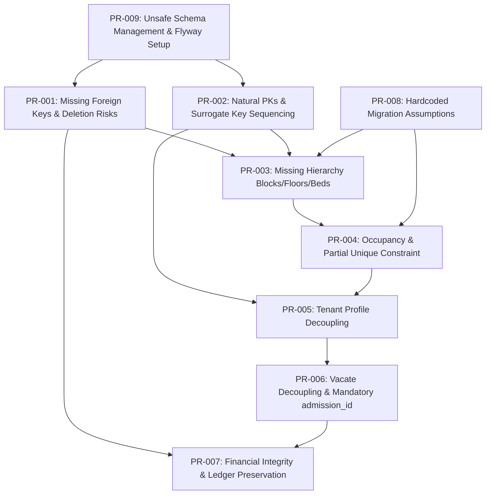

# Database Redesign Problem Register

**Project:** Residential Tenant Management and Rent Ledger (RMS)  
**Document Status:** Approved Technical Baseline  
**Audit Scope:** PostgreSQL 17 (`rms_db`), Spring Boot Backend (`rms-backend`), Existing Redesign Documentation  
**Audit Date:** October 18, 2026  

---

## Executive Overview

This Problem Register establishes the verified technical deficiencies, data integrity risks, architectural bottlenecks, and migration hazards identified across the RMS persistence layer. Every problem documented below is backed by empirical evidence gathered from:
1. Live database catalog inspection (`pg_constraint`, `pg_indexes`, `information_schema`, table row inspections on `rms_db`).
2. Source code audit of JPA entities, repositories, DTOs, and services in `com.rms.backend.*`.
3. Discrepancy analysis between historical audit documents (`current-schema-inventory.md`, `data-integrity-report.md`, `target-architecture.md`) and actual runtime behavior.

---

## Problem Index

| Problem ID | Category | Title | Severity | Implementation Phase |
| :--- | :--- | :--- | :--- | :--- |
| **PR-001** | Referential Integrity | Incomplete Database-Enforced Foreign Keys & Cascading Delete Risks | Critical | Phase 1 (Expand) |
| **PR-002** | Primary Key Design | Natural String Primary Keys and Surrogate-Key Foreign Key Sequencing | High | Phase 3 & 4 (Expand/Migrate) |
| **PR-003** | Hierarchy Modeling | Missing Structural Hierarchy (`Property → Block → Floor → Room → Bed`) | High | Phase 2 & 3 (Expand/Migrate) |
| **PR-004** | Concurrency & Integrity | Occupancy Desynchronization and Flawed `UNIQUE (bed_id, status)` Constraint | Critical | Phase 3 & 5 (Expand/Validate) |
| **PR-005** | Domain Normalization | Coupling of Permanent Tenant Identity with Transient Stay Attributes | High | Phase 4 & 5 (Expand/Migrate) |
| **PR-006** | Lifecycle Integrity | Vacate Workflow Decoupled from Admissions and Incomplete Settlement | High | Phase 6 (Expand/Migrate) |
| **PR-007** | Financial Preservation | Mixed Precision, Orphaned Ledger References, and Cascading Delete Hazards | Critical | Phase 1, 7 & 9 (Protect/Validate) |
| **PR-008** | Migration Validity | Hardcoded Data Assumptions and Unverified Bed/Block Assignments | Medium | Phase 0 & Pre-Migration Gates |
| **PR-009** | Schema Management | Unsafe Hibernate Auto-DDL (`ddl-auto=update`) and Startup SQL Execution | Critical | Phase 0 & 1 (Infrastructure) |

---

## Detailed Problem Specifications

### Problem 1: Incomplete Database-Enforced Referential Integrity & Cascading Deletion Hazards (PR-001)

- **Problem ID:** PR-001
- **Current Behavior:** 
  The database relies primarily on application-layer logic to maintain referential integrity. Out of 10 active tables in `rms_db`, only two physical foreign keys exist in PostgreSQL:
  1. `admissions.room_no` &rarr; `rooms.room_no` (`fk6j2g2tty4ukvdgsqwe2ymjmtq`)
  2. `admissions.tenant_uid` &rarr; `tenants.uid` (`fkie3wy2hxh07dq0a28nb0u3g62`)
  All other parent-child relationships (`properties` &rarr; `rooms`, `tenants`, `admissions`, `invoices`, `ledger_transactions`, `vacate_requests`, `payments`; `invoices` &rarr; `payments`; `invoices`/`payments` &rarr; `ledger_transactions`; `tenants` &rarr; `rooms`) are raw scalar columns (`BIGINT` or `VARCHAR`) with zero physical database constraints.
  Furthermore, `PropertyTtlScheduler.java` line 47 executes `propertyRepository.delete(prop)` upon TTL expiry. In a schema with cascade deletion, this would silently wipe out all rooms, tenants, admissions, invoices, and ledger records!
- **Evidence & Affected Tables/Code:**
  - Database Query: `information_schema.referential_constraints` returns exactly 2 rows.
  - Script Discrepancy: `src/main/resources/migration_property_identifier.sql` attempted to create `fk_*_property` foreign keys with `ON DELETE SET NULL`, but these were never applied to the active database.
  - Entities: `Room.java` line 42 (`@Column(name = "property_id") private Long propertyId;` - no `@ManyToOne`), `Tenant.java` line 54, `Invoice.java` line 36, `Payment.java` line 52, `LedgerTransaction.java` line 50, `VacateRequest.java` line 41.
  - Deletion logic: `PropertyTtlScheduler.java` line 47 (`propertyRepository.delete(prop)`).
- **Root Cause:** Rapid prototyping relied on Hibernate JPA without generating physical DDL foreign keys, combined with naive purge scheduling.
- **Business & Financial Impact:** High risk of orphaned financial records, dangling billing entries, and ghost tenants. An administrative deletion of a property or room can leave dangling invoices or admissions, corrupting accounting balances.
- **Proposed Solution:** Introduce physical foreign key constraints using an **Expand-Migrate-Validate-Contract (EMVC)** sequence. Enforce `ON DELETE RESTRICT` on all parent entities containing financial or audit history. Prohibit physical deletion of properties with historical children; update `PropertyTtlScheduler` to mark properties as `DECOMMISSIONED` instead of calling `delete()`.
- **Required Schema Changes:**
  ```sql
  ALTER TABLE rooms ADD CONSTRAINT fk_rooms_property FOREIGN KEY (property_id) REFERENCES properties(id) ON DELETE RESTRICT;
  ALTER TABLE tenants ADD CONSTRAINT fk_tenants_property FOREIGN KEY (property_id) REFERENCES properties(id) ON DELETE RESTRICT;
  ALTER TABLE admissions ADD CONSTRAINT fk_admissions_property FOREIGN KEY (property_id) REFERENCES properties(id) ON DELETE RESTRICT;
  ALTER TABLE invoices ADD CONSTRAINT fk_invoices_property FOREIGN KEY (property_id) REFERENCES properties(id) ON DELETE RESTRICT;
  ALTER TABLE payments ADD CONSTRAINT fk_payments_property FOREIGN KEY (property_id) REFERENCES properties(id) ON DELETE RESTRICT;
  ALTER TABLE payments ADD CONSTRAINT fk_payments_invoice FOREIGN KEY (invoice_id) REFERENCES invoices(id) ON DELETE RESTRICT;
  ALTER TABLE ledger_transactions ADD CONSTRAINT fk_ledger_property FOREIGN KEY (property_id) REFERENCES properties(id) ON DELETE RESTRICT;
  ALTER TABLE vacate_requests ADD CONSTRAINT fk_vacate_property FOREIGN KEY (property_id) REFERENCES properties(id) ON DELETE RESTRICT;
  ```
- **Required Backend Changes:** Update JPA entity mappings to reflect `@ManyToOne(fetch = FetchType.LAZY)`. Refactor `PropertyTtlScheduler` to retain historical records.
- **Data Migration Requirements:** Run pre-validation scripts to confirm 0 orphaned rows before adding constraints. (Current audit verified 0 orphans in test database).
- **Validation & Rollback Criteria:** Constraint addition is reversible via `ALTER TABLE ... DROP CONSTRAINT`. Validation passes when queries for `NOT IN (SELECT id FROM properties)` return 0 rows.
- **Dependencies & Implementation Phase:** Phase 1 (Foundation & Property Safeguards).
- **Acceptance Criteria:** Every table referencing `properties`, `rooms`, `tenants`, or `invoices` has an active, catalog-verified `FOREIGN KEY` constraint with `ON DELETE RESTRICT`.

---

### Problem 2: Natural Primary Keys for Rooms and Tenants & Foreign Key Sequencing (PR-002)

- **Problem ID:** PR-002
- **Current Behavior:** 
  - `rooms` uses `room_no` (`VARCHAR(255)`) as its primary key.
  - `tenants` uses `uid` (`VARCHAR(255)`) as its primary key.
  - In PostgreSQL, foreign keys cannot target a column unless it has an explicit `UNIQUE` or `PRIMARY KEY` constraint. Previous migration plans proposed adding surrogate `id` without creating immediate unique constraints, which would cause subsequent foreign key creations in child tables to fail immediately.
- **Evidence & Affected Tables/Code:**
  - Schema: `\d rooms` shows `rooms_pkey PRIMARY KEY, btree (room_no)`.
  - Schema: `\d tenants` shows `tenants_pkey PRIMARY KEY, btree (uid)`.
  - PostgreSQL Catalog Requirement: `ERROR: there is no unique constraint matching given keys for referenced table "rooms"`.
- **Root Cause:** Domain natural keys were assigned as physical primary keys during initial design, and migration sequencing overlooked PostgreSQL foreign key target prerequisite constraints.
- **Business & Financial Impact:**
  - Room Number Collisions: Prevents multi-property operations. Property A and Property B cannot both contain "Room 101" because `room_no` is globally unique across the database.
  - String Foreign Key Inefficiency: Foreign keys referencing string keys consume excessive index space and complicate room renumbering or tenant identity updates.
- **Proposed Solution (DEC-001):**
  1. Add surrogate `id BIGINT GENERATED ALWAYS AS IDENTITY` with an immediate `UNIQUE` constraint (`uk_rooms_surrogate_id`, `uk_tenants_surrogate_id`) to `rooms` and `tenants`.
  2. Scope room uniqueness to property/floor: `UNIQUE (property_id, room_number)`.
  3. Retain `tenants.uid` as a stable, globally unique alternate key (`VARCHAR(100) UNIQUE NOT NULL`) for external API contracts.
  4. Sequence migration: Add column + UNIQUE &rarr; Add child foreign keys targeting surrogate unique keys &rarr; Backfill &rarr; Contract phase promotes `id` to `PRIMARY KEY` and drops legacy string PKs.
- **Required Schema Changes:**
  ```sql
  -- Step 1 (Expand): Add surrogate columns with immediate UNIQUE constraints
  ALTER TABLE rooms ADD COLUMN id BIGINT GENERATED ALWAYS AS IDENTITY;
  ALTER TABLE rooms ADD CONSTRAINT uk_rooms_surrogate_id UNIQUE (id);
  ALTER TABLE rooms ADD CONSTRAINT uk_rooms_property_number UNIQUE (property_id, room_no);

  ALTER TABLE tenants ADD COLUMN id BIGINT GENERATED ALWAYS AS IDENTITY;
  ALTER TABLE tenants ADD CONSTRAINT uk_tenants_surrogate_id UNIQUE (id);
  ALTER TABLE tenants ADD CONSTRAINT uk_tenants_uid UNIQUE (uid);
  ```
- **Required Backend Changes:**
  - Update `Room` and `Tenant` entities to use `Long id` as `@Id`.
  - Retain `getRoomNo()` and `getUid()` across DTOs and API endpoints for non-breaking contract compatibility.
- **Data Migration Requirements:**
  - Populate `room_id` in `beds`, `admissions`, `vacate_requests` by joining on `rooms.room_no`.
  - Populate `tenant_id` in `admissions`, `invoices`, `payments`, `ledger_transactions`, `vacate_requests` by joining on `tenants.uid`.
- **Validation & Rollback Criteria:** PostgreSQL catalog confirms `uk_rooms_surrogate_id` and `uk_tenants_surrogate_id` exist before child FKs are applied.
- **Dependencies & Implementation Phase:** Phase 3 (Rooms) and Phase 4 (Tenants).
- **Acceptance Criteria:** `rooms.id` and `tenants.id` possess catalog-verified unique constraints and can be targeted by foreign keys without error.

---

### Problem 3: Missing Structural Hierarchy & False-Positive Floor Validation (PR-003)

- **Problem ID:** PR-003
- **Current Behavior:**
  - No `blocks`, `floors`, or `beds` tables exist.
  - `rooms.floor` is a flat free-text string storing values like `'1'`, `'2'`.
  - Previous migration scripts used regex `WHERE r.floor ~ '^[0-9]+$'`, silently skipping non-numeric floors (e.g. `'Ground'`, `'Basement'`), and validation queries used `INNER JOIN`, silently omitting unmapped rooms and producing false-positive passes!
- **Evidence & Affected Tables/Code:**
  - Database Catalog: Tables `blocks`, `floors`, `beds` do not exist.
  - `Room.java` line 25: `private String floor;` line 31: `private Integer occupancy;`.
  - False-Positive Hazard: `JOIN floors f ON r.floor_id = f.id` drops rooms where `floor_id IS NULL`, hiding unmapped rooms from validation results.
- **Root Cause:** Flat building modeling and incomplete mapping rules for non-numeric floor strings.
- **Business & Financial Impact:** Inability to allocate specific beds, inability to model multi-block properties, and risk of unmapped rooms disappearing from property floor plans.
- **Proposed Solution (DEC-002, DEC-008):**
  1. Introduce `blocks`, `floors`, and `beds` tables.
  2. Implement deterministic floor mapping supporting numeric floors, Ground (0), Basement (-1), and designated exception floors (999).
  3. Validate using `LEFT JOIN` and explicit `WHERE r.floor_id IS NULL` checks to eliminate false positives.
  4. Retain `rooms.property_id` alongside `rooms.floor_id` for fast property filtering, enforced via transactional logic and database validation queries.
- **Required Schema Changes:**
  ```sql
  CREATE TABLE blocks (
      id BIGINT GENERATED ALWAYS AS IDENTITY PRIMARY KEY,
      property_id BIGINT NOT NULL REFERENCES properties(id) ON DELETE RESTRICT,
      name VARCHAR(100) NOT NULL,
      code VARCHAR(50) NOT NULL,
      status VARCHAR(50) NOT NULL DEFAULT 'ACTIVE',
      created_at TIMESTAMPTZ NOT NULL DEFAULT NOW(),
      updated_at TIMESTAMPTZ NOT NULL DEFAULT NOW(),
      CONSTRAINT uk_blocks_property_code UNIQUE (property_id, code)
  );

  CREATE TABLE floors (
      id BIGINT GENERATED ALWAYS AS IDENTITY PRIMARY KEY,
      block_id BIGINT NOT NULL REFERENCES blocks(id) ON DELETE RESTRICT,
      floor_number INT NOT NULL,
      name VARCHAR(100) NOT NULL,
      status VARCHAR(50) NOT NULL DEFAULT 'ACTIVE',
      created_at TIMESTAMPTZ NOT NULL DEFAULT NOW(),
      updated_at TIMESTAMPTZ NOT NULL DEFAULT NOW(),
      CONSTRAINT uk_floors_block_number UNIQUE (block_id, floor_number)
  );
  ```
- **Required Backend Changes:** Create `Block`, `Floor`, `Bed` entities and repositories.
- **Data Migration Requirements:** Map all rooms deterministically. Assert `COUNT(rooms WHERE floor_id IS NULL) = 0`.
- **Validation & Rollback Criteria:** LEFT JOIN validation query returns 0 rows.
- **Dependencies & Implementation Phase:** Phase 2 (Blocks/Floors) and Phase 3 (Beds).
- **Acceptance Criteria:** 100% of rooms map to a valid floor. Zero false-positive validation passes.

---

### Problem 4: Admission and Occupancy Consistency & Broken Partial Unique Constraint (PR-004)

- **Problem ID:** PR-004
- **Current Behavior:**
  - Room occupancy is tracked through mutable integer counters on `rooms`: `current_occupancy`, `reserved_capacity`, and boolean `available`.
  - Previous redesign proposals suggested: `CONSTRAINT uk_admissions_bed_status UNIQUE (bed_id, status)`.
  - Backfill scripts naively joined beds to admissions without checking whether room capacity was exceeded, risking unassigned admissions.
- **Evidence & Affected Tables/Code:**
  - `Room.java` lines 33-40: `currentOccupancy`, `reservedCapacity`.
  - Flawed Proposal in `migration-plan.md` line 65: `Enforce UNIQUE (bed_id, status) where status in ('PENDING', 'PAID')`.
  - Flaw Proof: Allows Bed 1 to be `PENDING` (reserved by Tenant A) and `PAID` (occupied by Tenant B) at the same time. Also permanently blocks a second tenant from vacating Bed 1 in the future (`(1, 'VACATED')` collides).
- **Root Cause:** Table-level compound uniqueness fails to express mutual exclusion across multiple active states.
- **Business & Financial Impact:** Double-selling beds to multiple residents; counter drift between room counters and actual admissions.
- **Proposed Solution (DEC-003):**
  1. Eliminate `UNIQUE (bed_id, status)`.
  2. Implement PostgreSQL **Partial Unique Index**:
     ```sql
     CREATE UNIQUE INDEX uk_admissions_active_bed_exclusive
     ON admissions (bed_id)
     WHERE status IN ('PENDING', 'PAID') AND bed_id IS NOT NULL;
     ```
  3. Pre-migration assertion: Verify `active_admissions <= occupancy` for every room before allocating beds. Abort if violated.
  4. Post-allocation assertion: Verify `COUNT(admissions WHERE status IN ('PENDING', 'PAID') AND bed_id IS NULL) = 0`.
  5. Status Synchronization: Ensure `beds.status = 'OCCUPIED'` for `PAID`, `'RESERVED'` for `PENDING`, and `'AVAILABLE'` otherwise.
- **Required Schema Changes:** Add `bed_id BIGINT REFERENCES beds(id)` to `admissions` and create partial unique index.
- **Required Backend Changes:** Update `AdmissionService` with pessimistic locking on `beds` (`SELECT ... FOR UPDATE`).
- **Data Migration Requirements:** Map active admissions to beds deterministically.
- **Validation & Rollback Criteria:** Assertions guarantee zero unassigned admissions and exact count matching between bed statuses and admission statuses.
- **Dependencies & Implementation Phase:** Phase 3 (Beds) and Phase 5 (Admissions).
- **Acceptance Criteria:** Exactly one resident can occupy or reserve a bed at any given instant.

---

### Problem 5: Tenant Profile and Admission Separation (PR-005)

- **Problem ID:** PR-005
- **Current Behavior:**
  - `tenants` stores transient accommodation attributes directly on the resident row: `room_no`, `standard_rent`, `advance_paid`, `advance_paid_status`, `property_id`, `status`.
  - When an inactive tenant returns for a new stay, `AdmissionService.resolveOrCreateTenant()` directly **overwrites** `room_no`, `standard_rent`, and `advance_paid` on the tenant table.
- **Evidence & Affected Tables/Code:**
  - Schema: `tenants` table contains columns `room_no`, `advance_paid`, `standard_rent`, `status`.
  - `AdmissionService.java` lines 322-343: overwrites `tenant.setRoomNo()`, `tenant.setStandardRent()`, `tenant.setAdvancePaid()`.
- **Root Cause:** Lack of separation between permanent citizen identity and individual stay agreements.
- **Business & Financial Impact:** Destroys historical stay records on the tenant entity when a resident re-enrolls.
- **Proposed Solution (DEC-004):**
  1. Redefine `tenants` as a pure resident identity profile (KYC, contact details).
  2. Maintain all stay parameters (`room_id`, `bed_id`, `agreed_rent`, `deposit_paid`, stay interval) inside `admissions`.
  3. Relax `tenants.room_no`, `tenants.standard_rent`, `tenants.advance_paid` to nullable in Phase 4; drop in Phase 10.
- **Required Schema Changes:** Add `agreed_rent INT` and `deposit_paid INT` to `admissions`. Make legacy columns on `tenants` nullable.
- **Required Backend Changes:** Refactor `resolveOrCreateTenant` to never overwrite past financial agreements; create a fresh `Admission` row instead.
- **Data Migration Requirements:** Copy historical `advance_paid` and `standard_rent` from `tenants` into active admission records.
- **Validation & Rollback Criteria:** Verify that past vacated admissions retain historical rent and room assignments when a tenant re-enrolls.
- **Dependencies & Implementation Phase:** Phase 4 (Tenants) and Phase 5 (Admissions).
- **Acceptance Criteria:** A resident can have multiple historical admissions across different rooms/properties over time without mutating their permanent `tenants` identity record.

---

### Problem 6: Vacate Workflow Decoupling & Mandatory `admission_id` Lifecycle (PR-006)

- **Problem ID:** PR-006
- **Current Behavior:**
  - `vacate_requests` has NO foreign key to `admissions`.
  - Completing a vacate request marks `tenants.status = 'INACTIVE'`, but **never closes the `admissions` record** (leaving it active as `PAID`) and never records ledger settlement entries.
  - Previous documentation had no backfill strategy for historical vacate requests or specification of when `admission_id` becomes mandatory.
- **Evidence & Affected Tables/Code:**
  - `VacateRequest.java` line 25: `private String tenantUid;` line 31: `private String roomNo;` (no `admissionId`).
  - `VacateRequestService.java` lines 266-298 (`completeVacate` method): 0 calls to `admissionRepository`.
  - `AdmissionService.java` line 314: marks admissions `VACATED` *only* if the tenant subsequently returns and re-enrolls.
- **Root Cause:** Vacate processing was built as an independent notification module rather than the formal closure phase of an admission lifecycle.
- **Business & Financial Impact:** Severe data inconsistency: a tenant is marked `INACTIVE`, but their admission remains active (`PAID`), resulting in incorrect active resident counts and audit discrepancies.
- **Proposed Solution (DEC-005):**
  1. Add `admission_id BIGINT REFERENCES admissions(id) ON DELETE RESTRICT` to `vacate_requests`.
  2. Backfill historical vacate requests by matching tenant UID and room to the latest admission prior to the request date. Log unresolvable requests to `migration_exceptions`.
  3. Once backfill is validated (0 unmapped rows), execute `ALTER TABLE vacate_requests ALTER COLUMN admission_id SET NOT NULL;`.
  4. Make `completeVacate()` an atomic transactional workflow: close admission (`status = 'VACATED'`), free bed (`status = 'AVAILABLE'`), set tenant inactive, and emit ledger settlement entries.
- **Required Schema Changes:** Add `admission_id` column, foreign key constraint, and eventual `NOT NULL` constraint.
- **Required Backend Changes:** Link `admissionId` in `VacateRequestDto` and close admission atomically in `completeVacate()`.
- **Data Migration Requirements:** Deterministic backfill matching latest admission per stay.
- **Validation & Rollback Criteria:** Check `COUNT(*) FROM vacate_requests WHERE admission_id IS NULL = 0`.
- **Dependencies & Implementation Phase:** Phase 6 (Vacate & Historical Occupancy).
- **Acceptance Criteria:** Every vacate request links to a distinct admission. Completing a vacate request atomically marks the admission vacated and frees the bed.

---

### Problem 7: Financial Integrity, Nullable Ledger References, and Precision (PR-007)

- **Problem ID:** PR-007
- **Current Behavior:**
  - In `ledger_transactions`, existing rows have `invoice_id = NULL`, `payment_id = NULL`, and `tenant_uid = ''` (empty string).
  - In `payments`, there are currently 0 rows.
  - Monetary types are mixed: `INTEGER` in billing vs `DOUBLE PRECISION` in vacate requests.
  - Naively adding `NOT NULL` constraints on ledger foreign keys would corrupt or fail on existing historical records.
- **Evidence & Affected Tables/Code:**
  - Live Database: 3 ledger transactions present; total credits ₹19,500; `invoice_id` and `payment_id` are NULL.
  - Schema types: `\d vacate_requests` shows `double precision` for monetary columns.
- **Root Cause:** Ad-hoc ledger implementation without backfilling legacy transaction references, combined with inconsistent Java primitive typing.
- **Business & Financial Impact:** High financial risk: floating-point rounding errors and risk of corrupting immutable historical ledger entries.
- **Proposed Solution (DEC-007, DEC-010):**
  1. Standardize all monetary columns on exact `NUMERIC(12, 2)` with `RoundingMode.HALF_UP`.
  2. Financial Ledger Preservation Rule:
     - Existing primary keys, reference numbers, amounts, transaction types (`CREDIT`/`DEBIT`), and running balances must be treated as **strictly immutable**.
     - Foreign keys on `ledger_transactions` (`tenant_id`, `invoice_id`, `payment_id`) MUST remain **explicitly nullable** to preserve legacy and direct journal entries.
     - Reconcile historical ledger rows to invoices via `reference_number = transaction_ref` where correlation exists, without mutating amounts or balances.
     - Never fabricate synthetic payment rows or recalculate historical running balances.
  3. Apply `ON DELETE RESTRICT` to all financial relations. Prohibit physical deletion.
- **Required Schema Changes:**
  ```sql
  ALTER TABLE vacate_requests ALTER COLUMN advance_paid TYPE NUMERIC(12, 2);
  ALTER TABLE vacate_requests ALTER COLUMN advance_repayable TYPE NUMERIC(12, 2);
  ALTER TABLE vacate_requests ALTER COLUMN maintenance_charge TYPE NUMERIC(12, 2);
  ALTER TABLE vacate_requests ALTER COLUMN breakage_charge TYPE NUMERIC(12, 2);
  ```
- **Required Backend Changes:** Standardize Java entities on `BigDecimal` / exact decimal.
- **Data Migration Requirements:** Reconcile historical ledger rows to invoices without altering financial amounts.
- **Validation & Rollback Criteria:** Transaction-level financial reconciliation asserts $\Delta \text{Credits} = 0$, $\Delta \text{Debits} = 0$, $\Delta \text{Balance} = 0$.
- **Dependencies & Implementation Phase:** Phase 1 (Restraints), Phase 7 (Precision Harmonization), Phase 9 (Financial Audit).
- **Acceptance Criteria:** Financial history is 100% preserved. Monetary fields have exact precision. Zero historical records are deleted or modified.

---

### Problem 8: Unverified Existing Data & Migration Assumptions (PR-008)

- **Problem ID:** PR-008
- **Current Behavior:**
  - Previous redesign documents made hardcoded assumptions based on sample data (hardcoding "Main Block", assigning Biju K to Bed 100-1 and Rasul to Bed 100-2).
- **Evidence & Affected Tables/Code:**
  - `migration-plan.md` lines 38, 49-50: explicitly names Biju K and Rasul for Bed 100-1 and 100-2 without generic mapping logic.
- **Root Cause:** Extrapolating a universal migration strategy from a single prototype property dataset.
- **Business & Financial Impact:** In a production database with multiple properties, hardcoded blocks or naive bed assignments will cause primary key collisions and migration script failures.
- **Proposed Solution (DEC-008):**
  1. Build deterministic, parameterized migration scripts:
     - Generate blocks dynamically per property (`BLK-` || `properties.code`).
     - Map distinct `rooms.floor` strings deterministically to floors per block.
     - Generate bed slots dynamically: for a room with capacity $C$, generate beds numbered `1` through $C$.
     - Allocate existing active tenants to bed slots based on deterministic criteria (ordered by `enrollment_date`, `id`), asserting 0 unassigned active stays.
  2. Exception Handling: Flag ambiguous records into `migration_exceptions` table.
- **Required Schema Changes:** Create `migration_exceptions` table in Phase 0.
- **Required Backend Changes:** None for runtime; scripts executed through migration tools.
- **Data Migration Requirements:** Verified SQL mappings operating strictly over relational sets without hardcoded IDs.
- **Validation & Rollback Criteria:** Zero unmapped tenants or rooms.
- **Dependencies & Implementation Phase:** Phase 0 (Baseline Validation) and Phase 2 & 3.
- **Acceptance Criteria:** Migration scripts execute successfully against any property dataset without hardcoded entity names or IDs.

---

### Problem 9: Unsafe Schema Management & Flyway Dual-Environment Setup (PR-009)

- **Problem ID:** PR-009
- **Current Behavior:**
  - `application.properties` specifies: `spring.jpa.hibernate.ddl-auto=update`.
  - `DataInitializer.java` executes unversioned, imperatively coded SQL `ALTER TABLE` and `UPDATE` statements on every application boot.
  - Previous migration plan did not explain how Flyway handles both existing databases with active data and fresh clean databases in CI/CD.
- **Evidence & Affected Tables/Code:**
  - `application.properties` line 15: `spring.jpa.hibernate.ddl-auto=update`.
  - `DataInitializer.java` lines 35-68: executes `jdbcTemplate.execute("ALTER TABLE properties ADD COLUMN IF NOT EXISTS...")`.
- **Root Cause:** Convenience setup for local rapid prototyping left active in backend configuration.
- **Business & Financial Impact:** Hibernate `update` does not drop unused columns, does not reliably apply complex constraints, fails on table renames, and can lock tables or alter types unexpectedly during server restarts.
- **Proposed Solution (DEC-009):**
  1. Transition `application.properties` to `spring.jpa.hibernate.ddl-auto=validate` for all environments.
  2. Implement Flyway Dual-Environment Setup:
     - **Existing Database (`rms_db`):** Baseline at version `0` (`baselineOnMigrate=true`, `baselineVersion=0`). Apply `V1`..`V10` on top.
     - **Fresh / Clean Database (CI/CD):** Execute `V0__baseline_schema.sql` to build the baseline schema, then apply `V1`..`V10` sequentially.
  3. Purge all DDL execution from `DataInitializer.java`.
- **Required Schema Changes:** Introduce `flyway_schema_history` and `migration_exceptions`.
- **Required Backend Changes:** Add Flyway dependencies to `pom.xml`; set `ddl-auto=validate`.
- **Data Migration Requirements:** Baseline existing active database as `V0__baseline_schema.sql`.
- **Validation & Rollback Criteria:** Application starts cleanly with `ddl-auto=validate` against both upgraded and clean databases.
- **Dependencies & Implementation Phase:** Phase 0 (Pre-condition for all structural migrations).
- **Acceptance Criteria:** Zero DDL execution from Hibernate or Java startup code. 100% of schema changes managed by version-controlled migration scripts.

---

## Problem Interdependency Matrix



This register provides the definitive baseline against which all architecture documents, decision logs, migration plans, and validation procedures are aligned.
