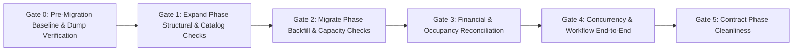

# Database Redesign Automated Validation Plan & Test Suite

**Project:** Residential Tenant Management and Rent Ledger (RMS)  
**Execution Stage:** Pre-Migration, Migration Verification, and Post-Cutover Testing  
**Database:** PostgreSQL 17 (`rms_db`)  
**Backend:** Spring Boot 3.x (`com.rms.backend.*`)  
**Document Status:** Approved Technical Baseline  

---

## 1. Overview & Quality Gates

This automated validation plan specifies the verification harness, SQL diagnostic queries, integration test cases, and measurable pass/fail thresholds required at every phase of the database redesign. No migration step is deemed complete until all tests in the corresponding phase pass with zero errors.

### Validation Quality Gates



---

## 2. Comprehensive Test Matrix (15 Verification Areas)

### Area 1: Primary-Key & Surrogate-Key Uniqueness

- **Objective:** Verify that every table has a valid, non-null, uniquely indexed primary key, and that surrogate keys (`rooms.id`, `tenants.id`) have active unique constraints in the PostgreSQL catalog *before* foreign keys reference them.
- **SQL Verification Check:**
  ```sql
  -- 1.1 Verify no NULL or duplicate Primary Keys across all core tables
  SELECT 'properties' AS tbl, COUNT(*) AS null_or_dup_pks
  FROM properties WHERE id IS NULL OR id IN (SELECT id FROM properties GROUP BY id HAVING COUNT(*) > 1)
  UNION ALL
  SELECT 'blocks', COUNT(*) FROM blocks WHERE id IS NULL OR id IN (SELECT id FROM blocks GROUP BY id HAVING COUNT(*) > 1)
  UNION ALL
  SELECT 'floors', COUNT(*) FROM floors WHERE id IS NULL OR id IN (SELECT id FROM floors GROUP BY id HAVING COUNT(*) > 1)
  UNION ALL
  SELECT 'rooms', COUNT(*) FROM rooms WHERE id IS NULL OR id IN (SELECT id FROM rooms GROUP BY id HAVING COUNT(*) > 1)
  UNION ALL
  SELECT 'beds', COUNT(*) FROM beds WHERE id IS NULL OR id IN (SELECT id FROM beds GROUP BY id HAVING COUNT(*) > 1)
  UNION ALL
  SELECT 'tenants', COUNT(*) FROM tenants WHERE id IS NULL OR id IN (SELECT id FROM tenants GROUP BY id HAVING COUNT(*) > 1)
  UNION ALL
  SELECT 'admissions', COUNT(*) FROM admissions WHERE id IS NULL OR id IN (SELECT id FROM admissions GROUP BY id HAVING COUNT(*) > 1)
  UNION ALL
  SELECT 'invoices', COUNT(*) FROM invoices WHERE id IS NULL OR id IN (SELECT id FROM invoices GROUP BY id HAVING COUNT(*) > 1)
  UNION ALL
  SELECT 'payments', COUNT(*) FROM payments WHERE id IS NULL OR id IN (SELECT id FROM payments GROUP BY id HAVING COUNT(*) > 1)
  UNION ALL
  SELECT 'ledger_transactions', COUNT(*) FROM ledger_transactions WHERE id IS NULL OR id IN (SELECT id FROM ledger_transactions GROUP BY id HAVING COUNT(*) > 1);

  -- 1.2 Verify surrogate unique constraints in pg_constraint (Priority 1 Check)
  SELECT conname, contype 
  FROM pg_constraint 
  WHERE conname IN ('uk_rooms_surrogate_id', 'uk_tenants_surrogate_id', 'rooms_pkey', 'tenants_pkey');
  ```
- **Pass/Fail Criteria:** Every row in 1.1 must return `null_or_dup_pks = 0`. Query 1.2 must confirm active unique/PK constraints.

---

### Area 2: Foreign-Key Validity & Orphan Detection

- **Objective:** Verify that 100% of foreign-key columns point to existing parent rows in target tables, and that all foreign keys enforce `ON DELETE RESTRICT`.
- **SQL Verification Check:**
  ```sql
  -- 2.1 Orphan detection across all relationships
  SELECT 'rooms_without_property' AS check_name, COUNT(*) AS orphan_count
  FROM rooms WHERE property_id NOT IN (SELECT id FROM properties)
  UNION ALL
  SELECT 'rooms_without_floor', COUNT(*)
  FROM rooms WHERE floor_id IS NOT NULL AND floor_id NOT IN (SELECT id FROM floors)
  UNION ALL
  SELECT 'floors_without_block', COUNT(*)
  FROM floors WHERE block_id NOT IN (SELECT id FROM blocks)
  UNION ALL
  SELECT 'blocks_without_property', COUNT(*)
  FROM blocks WHERE property_id NOT IN (SELECT id FROM properties)
  UNION ALL
  SELECT 'beds_without_room', COUNT(*)
  FROM beds WHERE room_id NOT IN (SELECT id FROM rooms)
  UNION ALL
  SELECT 'tenants_without_property', COUNT(*)
  FROM tenants WHERE property_id IS NOT NULL AND property_id NOT IN (SELECT id FROM properties)
  UNION ALL
  SELECT 'admissions_without_tenant', COUNT(*)
  FROM admissions WHERE tenant_id IS NOT NULL AND tenant_id NOT IN (SELECT id FROM tenants)
  UNION ALL
  SELECT 'admissions_without_room', COUNT(*)
  FROM admissions WHERE room_id IS NOT NULL AND room_id NOT IN (SELECT id FROM rooms)
  UNION ALL
  SELECT 'admissions_without_bed', COUNT(*)
  FROM admissions WHERE bed_id IS NOT NULL AND bed_id NOT IN (SELECT id FROM beds)
  UNION ALL
  SELECT 'invoices_without_property', COUNT(*)
  FROM invoices WHERE property_id IS NOT NULL AND property_id NOT IN (SELECT id FROM properties)
  UNION ALL
  SELECT 'payments_without_invoice', COUNT(*)
  FROM payments WHERE invoice_id NOT IN (SELECT id FROM invoices)
  UNION ALL
  SELECT 'ledger_without_property', COUNT(*)
  FROM ledger_transactions WHERE property_id IS NOT NULL AND property_id NOT IN (SELECT id FROM properties);
  ```
- **Pass/Fail Criteria:** All checks must return `orphan_count = 0`.

---

### Area 3: Property/Block/Floor/Room Hierarchy Consistency

- **Objective:** Guarantee that the structural parentage is strictly non-divergent: `Room &rarr; Floor &rarr; Block &rarr; Property`. A room's `property_id` must match its parent floor's parent block's `property_id`. Unmapped rooms must cause explicit failures (Priority 2 Fix).
- **SQL Verification Check:**
  ```sql
  -- 3.1 Check for unmapped rooms (Must return 0)
  SELECT COUNT(*) AS unmapped_rooms
  FROM rooms
  WHERE floor_id IS NULL;

  -- 3.2 Hierarchy Consistency Check using LEFT JOIN (prevents false-positive passes)
  SELECT 
      r.id AS room_id,
      r.room_no,
      r.property_id AS room_property_id,
      b.property_id AS block_property_id
  FROM rooms r
  LEFT JOIN floors f ON r.floor_id = f.id
  LEFT JOIN blocks b ON f.block_id = b.id
  WHERE f.id IS NULL OR b.id IS NULL OR r.property_id != b.property_id;
  ```
- **Pass/Fail Criteria:** `unmapped_rooms = 0`; 3.2 returns **0 rows**.

---

### Area 4: Room and Bed Capacity Reconciliation

- **Objective:** Ensure the number of configured beds in each room matches the room's declared `occupancy` capacity exactly.
- **SQL Verification Check:**
  ```sql
  SELECT 
      r.id AS room_id,
      r.room_no,
      r.occupancy AS declared_capacity,
      COUNT(b.id) AS physical_bed_count,
      (r.occupancy - COUNT(b.id)) AS discrepancy
  FROM rooms r
  LEFT JOIN beds b ON r.id = b.room_id
  GROUP BY r.id, r.room_no, r.occupancy
  HAVING r.occupancy != COUNT(b.id);
  ```
- **Pass/Fail Criteria:** Query returns **0 rows**. Every room has exactly $N$ bed records where $N = \text{occupancy}$.

---

### Area 5: Duplicate Active or Reserved Bed Allocations & Status Sync

- **Objective:** Enforce that no bed is concurrently occupied or reserved by multiple admissions, and that bed statuses perfectly synchronize with admissions (Priority 3 Fix).
- **SQL Verification Check:**
  ```sql
  -- 5.1 Detect bed collisions across active or pending admissions
  SELECT 
      bed_id,
      COUNT(*) AS active_admissions_count,
      ARRAY_AGG(admission_number) AS colliding_admissions,
      ARRAY_AGG(status) AS colliding_statuses
  FROM admissions
  WHERE bed_id IS NOT NULL 
    AND status IN ('PENDING', 'PAID')
  GROUP BY bed_id
  HAVING COUNT(*) > 1;

  -- 5.2 Verify bed status perfectly mirrors admission counts
  SELECT 
      (SELECT COUNT(*) FROM beds WHERE status = 'OCCUPIED') AS occupied_beds,
      (SELECT COUNT(*) FROM admissions WHERE status = 'PAID') AS paid_admissions,
      (SELECT COUNT(*) FROM beds WHERE status = 'RESERVED') AS reserved_beds,
      (SELECT COUNT(*) FROM admissions WHERE status = 'PENDING') AS pending_admissions;

  -- 5.3 Verify partial unique index exists in pg_indexes
  SELECT indexname, indexdef 
  FROM pg_indexes 
  WHERE indexname = 'uk_admissions_active_bed_exclusive';
  ```
- **Pass/Fail Criteria:**
  - 5.1 returns 0 rows.
  - In 5.2: `occupied_beds == paid_admissions` and `reserved_beds == pending_admissions`.
  - In 5.3: Index exists and covers `status IN ('PENDING', 'PAID')`.

---

### Area 6: Tenant Admission History Integrity

- **Objective:** Verify that every tenant profile has an unbroken audit trail of stays, and no tenant possesses overlapping active stays.
- **SQL Verification Check:**
  ```sql
  -- 6.1 Detect multiple active stays for the same tenant
  SELECT 
      tenant_id,
      COUNT(*) AS active_stays_count,
      ARRAY_AGG(admission_number) AS active_admissions
  FROM admissions
  WHERE status IN ('PENDING', 'PAID')
  GROUP BY tenant_id
  HAVING COUNT(*) > 1;

  -- 6.2 Verify date coherence
  SELECT COUNT(*) AS invalid_admission_dates
  FROM admissions
  WHERE enrollment_date IS NULL 
     OR (vacated_on IS NOT NULL AND vacated_on < enrollment_date);
  ```
- **Pass/Fail Criteria:** Zero multiple active stays (`active_stays_count <= 1`); `invalid_admission_dates = 0`.

---

### Area 7: Admission-to-Vacate Consistency

- **Objective:** Verify that every completed vacate request closes the corresponding admission, frees the bed, and maintains date consistency (Priority 4 Fix).
- **SQL Verification Check:**
  ```sql
  -- 7.1 Vacate requests without admission_id
  SELECT COUNT(*) AS unlinked_vacate_requests
  FROM vacate_requests
  WHERE admission_id IS NULL;

  -- 7.2 Vacate request pointing to non-vacated admission
  SELECT 
      vr.id AS vacate_id,
      vr.request_id,
      a.admission_number,
      vr.status AS vacate_status,
      a.status AS admission_status
  FROM vacate_requests vr
  JOIN admissions a ON vr.admission_id = a.id
  WHERE vr.status = 'COMPLETED' AND a.status != 'VACATED';

  -- 7.3 Vacate date coherence
  SELECT vr.id, vr.expected_leaving_date, vr.request_date
  FROM vacate_requests vr
  WHERE vr.expected_leaving_date < vr.request_date;
  ```
- **Pass/Fail Criteria:** All 3 checks return **0 rows**.

---

### Area 8: Invoice/Payment/Ledger Reference Integrity

- **Objective:** Verify referential integrity between invoices, payments, and double-entry ledger transactions while respecting legacy nullability (Priority 5 Fix).
- **SQL Verification Check:**
  ```sql
  -- 8.1 Payments referencing missing invoices
  SELECT COUNT(*) AS orphaned_payments
  FROM payments
  WHERE invoice_id NOT IN (SELECT id FROM invoices);

  -- 8.2 Ledger transactions referencing non-existent invoices or payments
  SELECT COUNT(*) AS invalid_ledger_invoices
  FROM ledger_transactions
  WHERE invoice_id IS NOT NULL AND invoice_id NOT IN (SELECT id FROM invoices);

  SELECT COUNT(*) AS invalid_ledger_payments
  FROM ledger_transactions
  WHERE payment_id IS NOT NULL AND payment_id NOT IN (SELECT id FROM payments);

  -- 8.3 Invoice paid_amount consistency with modern payments
  SELECT 
      i.id AS invoice_id,
      i.invoice_number,
      i.paid_amount,
      COALESCE(SUM(p.amount), 0) AS actual_payments_sum,
      (i.paid_amount - COALESCE(SUM(p.amount), 0)) AS diff
  FROM invoices i
  LEFT JOIN payments p ON i.id = p.invoice_id AND p.status = 'SUCCESS'
  GROUP BY i.id, i.invoice_number, i.paid_amount
  HAVING i.paid_amount != COALESCE(SUM(p.amount), 0)
     AND (SELECT COUNT(*) FROM payments WHERE invoice_id = i.id) > 0;
  ```
- **Pass/Fail Criteria:** Zero orphaned payments; zero invalid ledger references; modern invoice payments match payment records 100%.

---

### Area 9: Financial Balance Reconciliation Before and After Migration

- **Objective:** Guarantee that total ledger balances, total cash debits/credits, and invoice receivables are 100% preserved during migration with zero drift (Priority 5 & 7 Fix).
- **SQL Transaction-Level Reconciliation Query:**
  ```sql
  WITH baseline AS (
      SELECT 
          3 AS base_txns,
          19500.00 AS base_credits,
          0.00 AS base_debits,
          19500 AS base_balance
  ),
  current_ledger AS (
      SELECT 
          COUNT(*) AS cur_txns,
          COALESCE(SUM(CASE WHEN type = 'CREDIT' THEN amount ELSE 0 END), 0) AS cur_credits,
          COALESCE(SUM(CASE WHEN type = 'DEBIT' THEN amount ELSE 0 END), 0) AS cur_debits,
          COALESCE(MAX(running_balance), 0) AS cur_balance
      FROM ledger_transactions
  )
  SELECT 
      (cur_txns - base_txns) AS delta_txns,
      (cur_credits - base_credits) AS delta_credits,
      (cur_debits - base_debits) AS delta_debits,
      (cur_balance - base_balance) AS delta_balance
  FROM baseline, current_ledger;
  ```
- **Pass/Fail Criteria:** All 4 delta values must equal **exactly 0**.

---

### Area 10: Legacy Identifier Compatibility & Index Coverage

- **Objective:** Verify that all legacy external identifiers (`tenants.uid`, `rooms.room_no`, `admissions.admission_number`, `invoices.invoice_number`, `vacate_requests.request_id`) remain fully discoverable and unique.
- **SQL Verification Check:**
  ```sql
  SELECT tablename, indexname 
  FROM pg_indexes 
  WHERE schemaname = 'public' 
    AND indexname IN (
        'uk_tenants_uid',
        'uk_admissions_admission_number',
        'uk_invoices_invoice_number',
        'uk_payments_payment_ref',
        'uk_vacate_requests_request_id',
        'uk_rooms_property_number'
    );
  ```
- **Pass/Fail Criteria:** All 6 unique indexes must exist in `pg_indexes`.

---

### Area 11: API and DTO Backward Compatibility

- **Objective:** Ensure existing frontend web clients and external webhooks continue receiving and sending data without contract breakage.
- **Spring Boot Automated Tests (`src/test/java/...`):**
  1. `RoomControllerTest.getRoomByNo_ReturnsLegacyPayload()`: Validates that GET `/api/rooms/100` returns JSON with `roomNo`, `floor`, `occupancy`, `currentOccupancy`, `available`.
  2. `TenantControllerTest.getTenantByUid_ReturnsLegacyPayload()`: Validates that GET `/api/tenants/{uid}` returns `uid`, `name`, `roomNo`, `advancePaid`, `standardRent`.
  3. `AdmissionControllerTest.createEnrollment_AcceptsRoomNo()`: Validates that POST `/api/admissions` accepts string `roomNo` and maps it to underlying `roomId` and `bedId`.
- **Pass/Fail Criteria:** 100% of existing controller integration tests pass.

---

### Area 12: Migration Idempotency, Retry, and Recovery Behavior

- **Objective:** Prove that migration scripts are completely idempotent: executing a migration twice in succession must not cause errors, duplicate rows, or lock escalation.
- **Validation Procedure:**
  1. Execute Flyway migration scripts `V1` through `V7`.
  2. Re-execute the scripts in a test staging environment.
  3. Verify that all statements execute safely without error.
- **Pass/Fail Criteria:** Zero SQL errors on re-execution. `flyway_schema_history` records all migrations with `success = true`.

---

### Area 13: Concurrent Admission Attempts (Double-Booking Guard)

- **Objective:** Prove that two concurrent HTTP threads attempting to enroll into the same vacant bed result in exactly one success and one deterministic rejection.
- **Backend Concurrency Test (`AdmissionConcurrencyTest.java`):**
  ```java
  @Test
  void testConcurrentEnrollment_SameBed_OnlyOneSucceeds() throws Exception {
      ExecutorService executor = Executors.newFixedThreadPool(2);
      CountDownLatch latch = new CountDownLatch(1);
      
      Callable<Integer> task = () -> {
          latch.await();
          try {
              admissionService.createEnrollment(testDto);
              return 200;
          } catch (DuplicateResourceException e) {
              return 409;
          }
      };

      Future<Integer> f1 = executor.submit(task);
      Future<Integer> f2 = executor.submit(task);
      latch.countDown();

      List<Integer> results = List.of(f1.get(), f2.get());
      assertTrue(results.contains(200));
      assertTrue(results.contains(409));
  }
  ```
- **Pass/Fail Criteria:** Exactly one thread receives HTTP 200/201; the second receives HTTP 409 Conflict. Bed occupancy in database equals exactly 1.

---

### Area 14: End-to-End Resident Lifecycle Workflows

- **Objective:** Validate the complete operational workflow from intake to checkout:
  $$\text{Enrollment} \longrightarrow \text{Confirmation} \longrightarrow \text{Billing} \longrightarrow \text{Payment} \longrightarrow \text{Vacate Notice} \longrightarrow \text{Settlement}$$
- **Verification Steps:**
  1. **Enroll:** Bed transitions `AVAILABLE` &rarr; `RESERVED`; admission created with status `PENDING`.
  2. **Confirm:** Bed transitions `RESERVED` &rarr; `OCCUPIED`; admission status `PAID`; tenant status `ACTIVE`.
  3. **Bill:** Invoice generated for resident stay.
  4. **Pay:** Payment recorded; invoice status `PAID`; ledger transaction appended with exact running balance.
  5. **Notice:** Vacate request submitted; status `PENDING` &rarr; `APPROVED`.
  6. **Complete:** Vacate request `COMPLETED`; admission status `VACATED`; bed status transitions `OCCUPIED` &rarr; `AVAILABLE`; tenant status `INACTIVE`.
- **Pass/Fail Criteria:** All entity states transition according to the verified state machine with 0 orphaned records and clean accounting balance.

---

### Area 15: Source vs Target Row-Count Comparison & Clean-Environment Validation

- **Objective:** Ensure not a single row is lost during migration, and verify that the entire redesigned schema deploys successfully from scratch on a clean PostgreSQL instance with Hibernate `ddl-auto=validate`.
- **Source vs Target Row-Count Query:**
  ```sql
  SELECT 'properties' AS entity, 1 AS baseline_count, COUNT(*) AS current_count, (COUNT(*) - 1) AS diff FROM properties
  UNION ALL
  SELECT 'rooms', 6, COUNT(*), (COUNT(*) - 6) FROM rooms
  UNION ALL
  SELECT 'tenants', 3, COUNT(*), (COUNT(*) - 3) FROM tenants
  UNION ALL
  SELECT 'admissions', 3, COUNT(*), (COUNT(*) - 3) FROM admissions
  UNION ALL
  SELECT 'invoices', 4, COUNT(*), (COUNT(*) - 4) FROM invoices
  UNION ALL
  SELECT 'ledger_transactions', 3, COUNT(*), (COUNT(*) - 3) FROM ledger_transactions;
  ```
- **Clean Deployment Check:**
  1. Initialize clean database `rms_test_clean`.
  2. Run all Flyway migrations from `V0` through `V7`.
  3. Boot Spring Boot backend with `spring.jpa.hibernate.ddl-auto=validate`.
- **Pass/Fail Criteria:** All row-count `diff` values equal 0. Backend boots with **zero schema validation errors** (`SchemaManagementException: 0`).

---

## 3. Automated Validation Execution Script

A companion SQL validation script `validate_redesign_integrity.sql` will be committed to `src/main/resources/` to run all SQL checks in a single automated CI/CD pipeline step, returning a unified health report:

```sql
DO $$
DECLARE
    v_orphans INT;
    v_unmapped_floors INT;
    v_unassigned_admissions INT;
    v_collisions INT;
BEGIN
    SELECT COUNT(*) INTO v_orphans FROM rooms WHERE property_id NOT IN (SELECT id FROM properties);
    IF v_orphans > 0 THEN
        RAISE EXCEPTION 'Validation Failed: % orphaned rooms detected!', v_orphans;
    END IF;

    SELECT COUNT(*) INTO v_unmapped_floors FROM rooms WHERE floor_id IS NULL;
    IF v_unmapped_floors > 0 THEN
        RAISE EXCEPTION 'Validation Failed: % unmapped rooms detected!', v_unmapped_floors;
    END IF;

    SELECT COUNT(*) INTO v_unassigned_admissions FROM admissions WHERE status IN ('PENDING', 'PAID') AND bed_id IS NULL;
    IF v_unassigned_admissions > 0 THEN
        RAISE EXCEPTION 'Validation Failed: % active admissions without bed!', v_unassigned_admissions;
    END IF;

    SELECT COUNT(*) INTO v_collisions FROM (
        SELECT bed_id FROM admissions WHERE status IN ('PENDING', 'PAID') AND bed_id IS NOT NULL GROUP BY bed_id HAVING COUNT(*) > 1
    ) sub;
    IF v_collisions > 0 THEN
        RAISE EXCEPTION 'Validation Failed: % bed collisions detected!', v_collisions;
    END IF;

    RAISE NOTICE 'SUCCESS: All Database Redesign Validation Checks Passed Cleanly.';
END $$;
```
