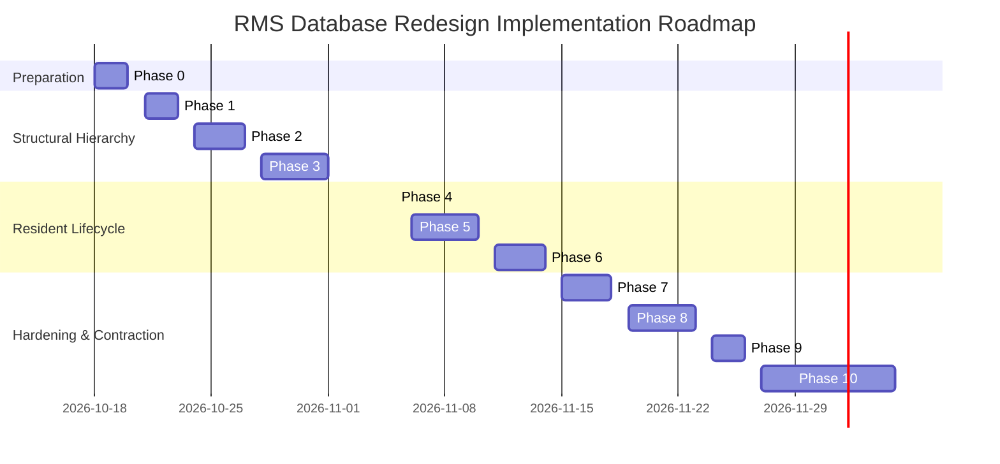

# Safe Incremental Migration Plan (Expand-Migrate-Validate-Contract)

**Project:** Residential Tenant Management and Rent Ledger (RMS)  
**Execution Methodology:** Phased Zero-Downtime Expand-Migrate-Validate-Contract (EMVC)  
**Tooling:** Flyway Versioned Migrations (`V1` to `V10`), PostgreSQL 17, Spring Boot 3.x  
**Safety Mandate:** Zero table drops, zero unverified data mutations, exact financial ledger preservation, backward-compatible APIs.

---

## 1. Migration Methodology & Architectural Guardrails

### Core Principles
1. **No Destructive Operations:** Existing tables, primary keys, and historical accounting rows are never dropped or recreated during active operational phases.
2. **Expand-Migrate-Validate-Contract (EMVC) Pattern:**
   - **Expand:** Add new structural tables, surrogate columns with immediate uniqueness constraints, indexes, and nullable foreign keys alongside existing structures without breaking the running backend.
   - **Migrate:** Backfill data using deterministic, repeatable SQL transformations within atomic transactions.
   - **Validate:** Verify 100% referential coverage, row counts, occupancy consistency, and mathematical balance equivalence using NULL-safe diagnostics before activating new application logic.
   - **Transition:** Switch backend entities and repositories to read/write against new structures while maintaining compatibility wrappers.
   - **Contract:** Deprecate and safely remove legacy columns only after all consumers have transitioned and an audited quarantine window has passed.
3. **Migration Governance & Dual-Environment Flyway Strategy:**
   - Eliminate Hibernate `ddl-auto=update` and eliminate startup DDL execution from `DataInitializer.java`.
   - Set `spring.jpa.hibernate.ddl-auto=validate`.
   - **Existing Database (`rms_db`):** Flyway baselines existing schema at version `0` (`baselineOnMigrate=true`, `baselineVersion=0`). Subsequent migrations `V1`..`V10` execute on top.
   - **Fresh / Clean Database (CI/CD & Staging):** Flyway executes `V0__baseline_schema.sql` to build the baseline schema, then applies `V1`..`V10` sequentially.
4. **Surrogate-Key Relational Sequencing:**
   - In PostgreSQL, foreign keys cannot reference a target column unless it has an explicit `UNIQUE` or `PRIMARY KEY` constraint.
   - `rooms.id` and `tenants.id` MUST receive `BIGINT GENERATED ALWAYS AS IDENTITY` along with an immediate `UNIQUE` constraint (`uk_rooms_surrogate_id`, `uk_tenants_surrogate_id`) *before* any child foreign keys reference them.
5. **Recovery Strategy:**
   - Schema additions are transactional in PostgreSQL (DDL is transactional).
   - If validation fails, transactions are automatically rolled back.
   - For deployed migrations, recovery is executed via forward-fix migrations or Point-in-Time Recovery (PITR) from pre-migration physical snapshots. Destructive `DOWN` scripts are prohibited on financial and occupancy entities.

---

## 2. Phase-by-Phase Implementation Roadmap



---

## 3. Detailed Phase Specifications

---

### Phase 0: Baseline Freeze & Flyway Dual-Environment Setup

- **Phase ID:** MIGR-P0
- **Prerequisites:**
  1. Full physical snapshot taken via `pg_dump -Fc -v -h localhost -U postgres rms_db > rms_db_phase0_baseline.dump`.
  2. Backup verified by test restoration into a temporary database `rms_db_verify_tmp`.
- **SQL / Migration Responsibilities:**
  - Create file `V0__baseline_schema.sql` capturing the active 10 tables, existing columns, and existing 2 foreign keys.
  - Create migration exception log table:
    ```sql
    CREATE TABLE IF NOT EXISTS migration_exceptions (
        id BIGINT GENERATED ALWAYS AS IDENTITY PRIMARY KEY,
        phase VARCHAR(50) NOT NULL,
        entity_type VARCHAR(50) NOT NULL,
        entity_identifier VARCHAR(255) NOT NULL,
        error_message TEXT NOT NULL,
        payload JSONB,
        logged_at TIMESTAMPTZ NOT NULL DEFAULT NOW(),
        resolved BOOLEAN NOT NULL DEFAULT FALSE
    );
    ```
- **Backend Configuration Responsibilities:**
  - Add Flyway dependencies to `pom.xml` (`flyway-core`, `flyway-database-postgresql`).
  - Configure `application.properties`:
    ```properties
    spring.jpa.hibernate.ddl-auto=validate
    spring.flyway.enabled=true
    spring.flyway.baseline-on-migrate=true
    spring.flyway.baseline-version=0
    spring.flyway.baseline-description=Baseline_As_Is_Schema
    ```
  - Purge all `ALTER TABLE` and `UPDATE` execution logic from `DataInitializer.java`.
- **Failure Conditions & Abort Triggers:**
  - Database connection fails.
  - Flyway baseline fails to register in `flyway_schema_history`.
  - Spring Boot fails to start with `SchemaManagementException`.
- **Automated Validation Queries & Pass Criteria:**
  ```sql
  -- 0.1 Verify Flyway schema history registered
  SELECT version, description, success FROM flyway_schema_history WHERE version = '0';
  -- Pass: 1 row returned with success = TRUE
  ```
- **Recovery Procedures:**
  - If Flyway baseline fails, delete corrupt `flyway_schema_history` and re-run baseline command.
- **Acceptance Criteria:**
  Application boots cleanly with `ddl-auto=validate` against both an upgraded existing database and a freshly initialized test database.

---

### Phase 1: Property Safeguards & Physical Foreign Keys (PR-001, DEC-006)

- **Phase ID:** MIGR-P1
- **Prerequisites:** Phase 0 complete and verified.
- **Pre-Migration Integrity Checks (Must Pass Before Execution):**
  ```sql
  -- Assert 0 orphaned property references exist before adding constraints
  SELECT 'orphaned_rooms' AS entity, COUNT(*) FROM rooms WHERE property_id NOT IN (SELECT id FROM properties)
  UNION ALL
  SELECT 'orphaned_tenants', COUNT(*) FROM tenants WHERE property_id NOT IN (SELECT id FROM properties)
  UNION ALL
  SELECT 'orphaned_admissions', COUNT(*) FROM admissions WHERE property_id NOT IN (SELECT id FROM properties)
  UNION ALL
  SELECT 'orphaned_invoices', COUNT(*) FROM invoices WHERE property_id NOT IN (SELECT id FROM properties)
  UNION ALL
  SELECT 'orphaned_ledger', COUNT(*) FROM ledger_transactions WHERE property_id NOT IN (SELECT id FROM properties);
  -- Must return 0 across all checks.
  ```
- **SQL Responsibilities (`V1__property_safeguards.sql`):**
  ```sql
  -- 1. Create indexes to prevent locking during FK enforcement
  CREATE INDEX IF NOT EXISTS idx_rooms_property_id ON rooms(property_id);
  CREATE INDEX IF NOT EXISTS idx_tenants_property_id ON tenants(property_id);
  CREATE INDEX IF NOT EXISTS idx_admissions_property_id ON admissions(property_id);
  CREATE INDEX IF NOT EXISTS idx_invoices_property_id ON invoices(property_id);
  CREATE INDEX IF NOT EXISTS idx_payments_property_id ON payments(property_id);
  CREATE INDEX IF NOT EXISTS idx_ledger_property_id ON ledger_transactions(property_id);
  CREATE INDEX IF NOT EXISTS idx_vacate_property_id ON vacate_requests(property_id);

  -- 2. Enforce physical foreign keys with ON DELETE RESTRICT
  ALTER TABLE rooms ADD CONSTRAINT fk_rooms_property FOREIGN KEY (property_id) REFERENCES properties(id) ON DELETE RESTRICT;
  ALTER TABLE tenants ADD CONSTRAINT fk_tenants_property FOREIGN KEY (property_id) REFERENCES properties(id) ON DELETE RESTRICT;
  ALTER TABLE admissions ADD CONSTRAINT fk_admissions_property FOREIGN KEY (property_id) REFERENCES properties(id) ON DELETE RESTRICT;
  ALTER TABLE invoices ADD CONSTRAINT fk_invoices_property FOREIGN KEY (property_id) REFERENCES properties(id) ON DELETE RESTRICT;
  ALTER TABLE payments ADD CONSTRAINT fk_payments_property FOREIGN KEY (property_id) REFERENCES properties(id) ON DELETE RESTRICT;
  ALTER TABLE payments ADD CONSTRAINT fk_payments_invoice FOREIGN KEY (invoice_id) REFERENCES invoices(id) ON DELETE RESTRICT;
  ALTER TABLE ledger_transactions ADD CONSTRAINT fk_ledger_property FOREIGN KEY (property_id) REFERENCES properties(id) ON DELETE RESTRICT;
  ALTER TABLE vacate_requests ADD CONSTRAINT fk_vacate_property FOREIGN KEY (property_id) REFERENCES properties(id) ON DELETE RESTRICT;
  ```
- **Failure Conditions & Abort Triggers:**
  - Any orphan detected raises an exception and aborts the Flyway transaction.
  - Lock timeout on high-volume tables.
- **Automated Validation Queries & Pass Criteria:**
  ```sql
  -- Verify all 8 constraints exist in pg_constraint with confdeltype = 'r' (RESTRICT)
  SELECT conname, confdeltype 
  FROM pg_constraint 
  WHERE conname IN (
      'fk_rooms_property', 'fk_tenants_property', 'fk_admissions_property',
      'fk_invoices_property', 'fk_payments_property', 'fk_payments_invoice',
      'fk_ledger_property', 'fk_vacate_property'
  );
  -- Pass: Exactly 8 rows returned, all with confdeltype = 'r'.
  ```
- **Recovery Procedures:**
  - If a constraint fails to apply due to data violations, Flyway rolls back the transaction. Resolve offending row in `migration_exceptions` and re-apply.
- **Acceptance Criteria:**
  All child tables enforce physical foreign keys to `properties(id)` with `RESTRICT`.

---

### Phase 2: Blocks and Floors Hierarchy (PR-003, DEC-002, DEC-008)

- **Phase ID:** MIGR-P2
- **Prerequisites:** Phase 1 complete.
- **SQL Responsibilities (`V2__blocks_and_floors_hierarchy.sql`):**
  ```sql
  -- 1. Create blocks table
  CREATE TABLE IF NOT EXISTS blocks (
      id BIGINT GENERATED ALWAYS AS IDENTITY PRIMARY KEY,
      property_id BIGINT NOT NULL REFERENCES properties(id) ON DELETE RESTRICT,
      name VARCHAR(100) NOT NULL,
      code VARCHAR(50) NOT NULL,
      status VARCHAR(50) NOT NULL DEFAULT 'ACTIVE',
      created_at TIMESTAMPTZ NOT NULL DEFAULT NOW(),
      updated_at TIMESTAMPTZ NOT NULL DEFAULT NOW(),
      CONSTRAINT uk_blocks_property_code UNIQUE (property_id, code)
  );
  CREATE INDEX IF NOT EXISTS idx_blocks_property_id ON blocks(property_id);

  -- 2. Create floors table
  CREATE TABLE IF NOT EXISTS floors (
      id BIGINT GENERATED ALWAYS AS IDENTITY PRIMARY KEY,
      block_id BIGINT NOT NULL REFERENCES blocks(id) ON DELETE RESTRICT,
      floor_number INT NOT NULL,
      name VARCHAR(100) NOT NULL,
      status VARCHAR(50) NOT NULL DEFAULT 'ACTIVE',
      created_at TIMESTAMPTZ NOT NULL DEFAULT NOW(),
      updated_at TIMESTAMPTZ NOT NULL DEFAULT NOW(),
      CONSTRAINT uk_floors_block_number UNIQUE (block_id, floor_number)
  );
  CREATE INDEX IF NOT EXISTS idx_floors_block_id ON floors(block_id);

  -- 3. Dynamic Backfill: Default block for every property
  INSERT INTO blocks (property_id, name, code, status)
  SELECT p.id, 'Main Block', 'BLK-' || p.code, 'ACTIVE'
  FROM properties p
  WHERE NOT EXISTS (SELECT 1 FROM blocks b WHERE b.property_id = p.id);

  -- 4. Dynamic Backfill: Extract numeric and special floors deterministically
  -- Step 4a: Numeric floors
  INSERT INTO floors (block_id, floor_number, name, status)
  SELECT DISTINCT 
      b.id,
      CAST(r.floor AS INT),
      'Floor ' || r.floor,
      'ACTIVE'
  FROM rooms r
  JOIN blocks b ON b.property_id = r.property_id
  WHERE r.floor ~ '^-?[0-9]+$'
    AND NOT EXISTS (
        SELECT 1 FROM floors f 
        WHERE f.block_id = b.id AND f.floor_number = CAST(r.floor AS INT)
    );

  -- Step 4b: Ground / Basement text variations
  INSERT INTO floors (block_id, floor_number, name, status)
  SELECT DISTINCT 
      b.id,
      CASE 
          WHEN LOWER(TRIM(r.floor)) IN ('g', 'ground', 'ground floor') THEN 0
          WHEN LOWER(TRIM(r.floor)) IN ('b', 'basement') THEN -1
          ELSE 999 -- Exception floor
      END,
      CASE 
          WHEN LOWER(TRIM(r.floor)) IN ('g', 'ground', 'ground floor') THEN 'Ground Floor'
          WHEN LOWER(TRIM(r.floor)) IN ('b', 'basement') THEN 'Basement'
          ELSE 'Floor ' || COALESCE(r.floor, 'Unassigned')
      END,
      'ACTIVE'
  FROM rooms r
  JOIN blocks b ON b.property_id = r.property_id
  WHERE (r.floor IS NULL OR NOT (r.floor ~ '^-?[0-9]+$'))
    AND NOT EXISTS (
        SELECT 1 FROM floors f 
        WHERE f.block_id = b.id AND f.floor_number = CASE 
            WHEN LOWER(TRIM(r.floor)) IN ('g', 'ground', 'ground floor') THEN 0
            WHEN LOWER(TRIM(r.floor)) IN ('b', 'basement') THEN -1
            ELSE 999
        END
    );

  -- 5. Expand rooms table with floor_id
  ALTER TABLE rooms ADD COLUMN IF NOT EXISTS floor_id BIGINT;

  -- 6. Link rooms.floor_id deterministically
  -- Numeric floors link
  UPDATE rooms r
  SET floor_id = f.id
  FROM floors f
  JOIN blocks b ON f.block_id = b.id
  WHERE r.property_id = b.property_id 
    AND r.floor ~ '^-?[0-9]+$'
    AND f.floor_number = CAST(r.floor AS INT)
    AND r.floor_id IS NULL;

  -- Non-numeric / NULL floors link
  UPDATE rooms r
  SET floor_id = f.id
  FROM floors f
  JOIN blocks b ON f.block_id = b.id
  WHERE r.property_id = b.property_id 
    AND (r.floor IS NULL OR NOT (r.floor ~ '^-?[0-9]+$'))
    AND f.floor_number = CASE 
        WHEN LOWER(TRIM(r.floor)) IN ('g', 'ground', 'ground floor') THEN 0
        WHEN LOWER(TRIM(r.floor)) IN ('b', 'basement') THEN -1
        ELSE 999
    END
    AND r.floor_id IS NULL;

  -- 7. Add foreign key on rooms.floor_id
  ALTER TABLE rooms ADD CONSTRAINT fk_rooms_floor 
      FOREIGN KEY (floor_id) REFERENCES floors(id) ON DELETE RESTRICT;
  CREATE INDEX IF NOT EXISTS idx_rooms_floor_id ON rooms(floor_id);
  ```
- **Failure Conditions & Abort Triggers:**
  - Any room remaining with `floor_id IS NULL` after backfill halts execution.
  - Property mismatch between room and block.
- **Automated Validation Queries & Pass Criteria:**
  ```sql
  -- 2.1 NULL-Safe Unmapped Room Check (Must return 0)
  SELECT COUNT(*) AS unmapped_rooms
  FROM rooms
  WHERE floor_id IS NULL;
  -- Pass: unmapped_rooms = 0

  -- 2.2 Hierarchy Consistency Check (LEFT JOIN prevents false-positive passes)
  SELECT r.room_no, r.property_id AS room_property, b.property_id AS block_property
  FROM rooms r
  LEFT JOIN floors f ON r.floor_id = f.id
  LEFT JOIN blocks b ON f.block_id = b.id
  WHERE f.id IS NULL OR b.id IS NULL OR r.property_id != b.property_id;
  -- Pass: Exactly 0 rows returned.
  ```
- **Recovery Procedures:**
  - Drop created foreign key and rollback transaction if unmapped rooms exist.
- **Acceptance Criteria:**
  100% of rooms link to a valid floor. No room has a property mismatch with its parent floor/block.

---

### Phase 3: Rooms Surrogate Key & Bed Inventory (PR-002, PR-003, DEC-001)

- **Phase ID:** MIGR-P3
- **Prerequisites:** Phase 2 complete.
- **Pre-Migration Capacity Checks:**
  ```sql
  -- Pre-check: Ensure no room has active admissions exceeding occupancy
  SELECT r.room_no, r.occupancy, COUNT(a.id) AS active_stays
  FROM rooms r
  LEFT JOIN admissions a ON r.room_no = a.room_no AND a.status IN ('PENDING', 'PAID')
  GROUP BY r.room_no, r.occupancy
  HAVING COUNT(a.id) > r.occupancy;
  -- Must return 0 rows. If > 0, migration ABORTS.
  ```
- **SQL Responsibilities (`V3__rooms_surrogate_and_beds.sql`):**
  ```sql
  -- 1. Add surrogate id to rooms with IMMEDIATE UNIQUE CONSTRAINT (Priority 1 fix)
  ALTER TABLE rooms ADD COLUMN IF NOT EXISTS id BIGINT GENERATED ALWAYS AS IDENTITY;
  ALTER TABLE rooms ADD CONSTRAINT uk_rooms_surrogate_id UNIQUE (id);

  -- 2. Add scoped uniqueness on room_no per property
  ALTER TABLE rooms ADD CONSTRAINT uk_rooms_property_number UNIQUE (property_id, room_no);

  -- 3. Create beds table
  CREATE TABLE IF NOT EXISTS beds (
      id BIGINT GENERATED ALWAYS AS IDENTITY PRIMARY KEY,
      room_id BIGINT NOT NULL,
      bed_number VARCHAR(50) NOT NULL,
      base_rent INT,
      status VARCHAR(50) NOT NULL DEFAULT 'AVAILABLE',
      created_at TIMESTAMPTZ NOT NULL DEFAULT NOW(),
      updated_at TIMESTAMPTZ NOT NULL DEFAULT NOW(),
      CONSTRAINT fk_beds_room FOREIGN KEY (room_id) REFERENCES rooms(id) ON DELETE CASCADE,
      CONSTRAINT uk_beds_room_number UNIQUE (room_id, bed_number)
  );
  CREATE INDEX IF NOT EXISTS idx_beds_room_id ON beds(room_id);
  CREATE INDEX IF NOT EXISTS idx_beds_status ON beds(status);

  -- 4. Auto-generate physical bed slots
  INSERT INTO beds (room_id, bed_number, base_rent, status)
  SELECT 
      r.id,
      'Bed ' || seq.n,
      r.rent_per_month,
      'AVAILABLE'
  FROM rooms r
  CROSS JOIN LATERAL generate_series(1, r.occupancy) AS seq(n)
  WHERE NOT EXISTS (
      SELECT 1 FROM beds b WHERE b.room_id = r.id AND b.bed_number = 'Bed ' || seq.n
  );
  ```
- **Failure Conditions & Abort Triggers:**
  - Duplicate `id` generated.
  - Number of generated beds does not match total room declared capacity.
- **Automated Validation Queries & Pass Criteria:**
  ```sql
  -- 3.1 Verify surrogate key uniqueness constraint exists in PostgreSQL catalog
  SELECT conname FROM pg_constraint WHERE conname = 'uk_rooms_surrogate_id' AND contype = 'u';
  -- Pass: 1 row returned.

  -- 3.2 Verify Bed count matches room declared occupancy exactly
  SELECT r.room_no, r.occupancy, COUNT(b.id) AS generated_beds
  FROM rooms r
  LEFT JOIN beds b ON r.id = b.room_id
  GROUP BY r.room_no, r.occupancy
  HAVING r.occupancy != COUNT(b.id);
  -- Pass: 0 rows returned.
  ```
- **Recovery Procedures:**
  - Clean rollback via Flyway transactional script.
- **Acceptance Criteria:**
  `rooms.id` has an active unique constraint. Every room has exactly $N$ beds where $N = \text{occupancy}$.

---

### Phase 4: Tenant Profile Decoupling (PR-002, PR-005, DEC-001, DEC-004)

- **Phase ID:** MIGR-P4
- **Prerequisites:** Phase 3 complete.
- **SQL Responsibilities (`V4__tenant_profile_decoupling.sql`):**
  ```sql
  -- 1. Add surrogate id to tenants with IMMEDIATE UNIQUE CONSTRAINT (Priority 1 fix)
  ALTER TABLE tenants ADD COLUMN IF NOT EXISTS id BIGINT GENERATED ALWAYS AS IDENTITY;
  ALTER TABLE tenants ADD CONSTRAINT uk_tenants_surrogate_id UNIQUE (id);

  -- 2. Verify and enforce unique index on legacy uid
  CREATE UNIQUE INDEX IF NOT EXISTS uk_tenants_uid ON tenants(uid);

  -- 3. Relax stay attributes on tenants to prepare for decoupling
  ALTER TABLE tenants ALTER COLUMN room_no DROP NOT NULL;
  ALTER TABLE tenants ALTER COLUMN standard_rent DROP NOT NULL;
  ALTER TABLE tenants ALTER COLUMN advance_paid DROP NOT NULL;
  ```
- **Failure Conditions & Abort Triggers:**
  - Non-unique `tenants.id` sequence generation.
  - Failure to establish `uk_tenants_surrogate_id`.
- **Automated Validation Queries & Pass Criteria:**
  ```sql
  -- 4.1 Verify tenant surrogate unique constraint exists in catalog
  SELECT conname FROM pg_constraint WHERE conname = 'uk_tenants_surrogate_id' AND contype = 'u';
  -- Pass: 1 row returned.

  -- 4.2 Verify 100% of tenants have non-null surrogate id and valid uid
  SELECT COUNT(*) FROM tenants WHERE id IS NULL OR uid IS NULL;
  -- Pass: 0.
  ```
- **Recovery Procedures:**
  - Drop constraints and rollback transaction.
- **Acceptance Criteria:**
  `tenants.id` has an active unique constraint ready to be targeted by foreign keys.

---

### Phase 5: Transactional Admissions & Partial Unique Bed Constraint (PR-004, DEC-003)

- **Phase ID:** MIGR-P5
- **Prerequisites:** Phase 3 and Phase 4 complete.
- **Pre-Migration Bed Allocation Pre-Checks:**
  ```sql
  -- Verify all admissions can resolve to a tenant and room
  SELECT COUNT(*) FROM admissions WHERE tenant_uid NOT IN (SELECT uid FROM tenants);
  SELECT COUNT(*) FROM admissions WHERE room_no NOT IN (SELECT room_no FROM rooms);
  -- Must return 0.
  ```
- **SQL Responsibilities (`V5__transactional_admissions.sql`):**
  ```sql
  -- 1. Expand admissions with surrogate foreign keys
  ALTER TABLE admissions ADD COLUMN IF NOT EXISTS tenant_id BIGINT;
  ALTER TABLE admissions ADD COLUMN IF NOT EXISTS room_id BIGINT;
  ALTER TABLE admissions ADD COLUMN IF NOT EXISTS bed_id BIGINT;
  ALTER TABLE admissions ADD COLUMN IF NOT EXISTS agreed_rent INT;
  ALTER TABLE admissions ADD COLUMN IF NOT EXISTS deposit_paid INT;

  -- 2. Backfill tenant_id and room_id
  UPDATE admissions a SET tenant_id = t.id FROM tenants t WHERE a.tenant_uid = t.uid AND a.tenant_id IS NULL;
  UPDATE admissions a SET room_id = r.id FROM rooms r WHERE a.room_no = r.room_no AND a.room_id IS NULL;

  -- 3. Copy rent and deposit baseline from tenant row if admission has none
  UPDATE admissions a
  SET agreed_rent = t.standard_rent,
      deposit_paid = t.advance_paid
  FROM tenants t
  WHERE a.tenant_id = t.id 
    AND a.agreed_rent IS NULL;

  -- 4. Deterministically allocate beds to active admissions (Priority 3 fix)
  WITH active_admissions AS (
      SELECT 
          a.id AS admission_id,
          a.room_id,
          ROW_NUMBER() OVER (PARTITION BY a.room_id ORDER BY a.enrollment_date, a.id) AS rn
      FROM admissions a
      WHERE a.status IN ('PENDING', 'PAID')
  ),
  room_beds AS (
      SELECT 
          b.id AS bed_id,
          b.room_id,
          ROW_NUMBER() OVER (PARTITION BY b.room_id ORDER BY b.id) AS rn
      FROM beds b
  )
  UPDATE admissions a
  SET bed_id = rb.bed_id
  FROM active_admissions aa
  JOIN room_beds rb ON aa.room_id = rb.room_id AND aa.rn = rb.rn
  WHERE a.id = aa.admission_id AND a.bed_id IS NULL;

  -- 5. Assert: Halt if any active/pending admission was not allocated a bed
  DO $$
  DECLARE
      v_unassigned INT;
  BEGIN
      SELECT COUNT(*) INTO v_unassigned 
      FROM admissions 
      WHERE status IN ('PENDING', 'PAID') AND bed_id IS NULL;

      IF v_unassigned > 0 THEN
          RAISE EXCEPTION 'MIGRATION HALTED: % active/pending admissions could not be assigned a bed!', v_unassigned;
      END IF;
  END $$;

  -- 6. Synchronize bed statuses with admission states
  UPDATE beds b
  SET status = 'OCCUPIED'
  WHERE b.id IN (SELECT bed_id FROM admissions WHERE status = 'PAID' AND bed_id IS NOT NULL);

  UPDATE beds b
  SET status = 'RESERVED'
  WHERE b.id IN (SELECT bed_id FROM admissions WHERE status = 'PENDING' AND bed_id IS NOT NULL);

  -- 7. Add foreign keys targeting surrogate unique keys
  ALTER TABLE admissions ADD CONSTRAINT fk_admissions_tenant FOREIGN KEY (tenant_id) REFERENCES tenants(id) ON DELETE RESTRICT;
  ALTER TABLE admissions ADD CONSTRAINT fk_admissions_room FOREIGN KEY (room_id) REFERENCES rooms(id) ON DELETE RESTRICT;
  ALTER TABLE admissions ADD CONSTRAINT fk_admissions_bed FOREIGN KEY (bed_id) REFERENCES beds(id) ON DELETE RESTRICT;

  -- 8. Apply PostgreSQL Partial Unique Index for active/reserved bed occupancy (DEC-003)
  CREATE UNIQUE INDEX IF NOT EXISTS uk_admissions_active_bed_exclusive
  ON admissions (bed_id)
  WHERE status IN ('PENDING', 'PAID') AND bed_id IS NOT NULL;
  ```
- **Failure Conditions & Abort Triggers:**
  - Any active admission left with `bed_id IS NULL`.
  - Duplicate bed assignment across active admissions.
  - Partial unique index creation fails due to collisions.
- **Automated Validation Queries & Pass Criteria:**
  ```sql
  -- 5.1 Verify 0 active admissions without a bed
  SELECT COUNT(*) FROM admissions WHERE status IN ('PENDING', 'PAID') AND bed_id IS NULL;
  -- Pass: 0.

  -- 5.2 Verify bed status perfectly matches admission counts
  SELECT 
      (SELECT COUNT(*) FROM beds WHERE status = 'OCCUPIED') AS occupied_beds,
      (SELECT COUNT(*) FROM admissions WHERE status = 'PAID') AS paid_admissions,
      (SELECT COUNT(*) FROM beds WHERE status = 'RESERVED') AS reserved_beds,
      (SELECT COUNT(*) FROM admissions WHERE status = 'PENDING') AS pending_admissions;
  -- Pass: occupied_beds == paid_admissions AND reserved_beds == pending_admissions.

  -- 5.3 Verify partial unique index exists in pg_indexes
  SELECT indexname, indexdef FROM pg_indexes WHERE indexname = 'uk_admissions_active_bed_exclusive';
  -- Pass: 1 row returned.
  ```
- **Recovery Procedures:**
  - Transaction rolls back automatically on assertion failure.
- **Acceptance Criteria:**
  Every active admission occupies a valid bed. At most one resident can hold a bed at any given instant.

---

### Phase 6: Vacate Workflow & Ledger Settlement Linkage (PR-006, DEC-005)

- **Phase ID:** MIGR-P6
- **Prerequisites:** Phase 5 complete.
- **SQL Responsibilities (`V6__vacate_workflow_settlement.sql`):**
  ```sql
  -- 1. Expand vacate_requests with surrogate keys and admission_id
  ALTER TABLE vacate_requests ADD COLUMN IF NOT EXISTS admission_id BIGINT;
  ALTER TABLE vacate_requests ADD COLUMN IF NOT EXISTS tenant_id BIGINT;
  ALTER TABLE vacate_requests ADD COLUMN IF NOT EXISTS room_id BIGINT;
  ALTER TABLE vacate_requests ADD COLUMN IF NOT EXISTS bed_id BIGINT;

  -- 2. Backfill tenant_id and room_id
  UPDATE vacate_requests vr SET tenant_id = t.id FROM tenants t WHERE vr.tenant_uid = t.uid AND vr.tenant_id IS NULL;
  UPDATE vacate_requests vr SET room_id = r.id FROM rooms r WHERE vr.room_no = r.room_no AND vr.room_id IS NULL;

  -- 3. Backfill admission_id for historical vacate requests (Priority 4 fix)
  -- Deterministically match to the latest admission for that tenant and room
  UPDATE vacate_requests vr
  SET admission_id = sub.admission_id,
      bed_id = sub.bed_id
  FROM (
      SELECT DISTINCT ON (vr2.id)
          vr2.id AS vacate_id,
          a.id AS admission_id,
          a.bed_id
      FROM vacate_requests vr2
      JOIN admissions a ON a.tenant_id = vr2.tenant_id AND a.room_id = vr2.room_id
      WHERE a.enrollment_date <= vr2.request_date
      ORDER BY vr2.id, a.enrollment_date DESC, a.id DESC
  ) sub
  WHERE vr.id = sub.vacate_id AND vr.admission_id IS NULL;

  -- 4. Check for unresolvable vacate requests (log to migration_exceptions)
  INSERT INTO migration_exceptions (phase, entity_type, entity_identifier, error_message, payload)
  SELECT 
      'Phase 6', 
      'vacate_requests', 
      vr.request_id, 
      'Could not resolve admission_id for vacate request', 
      to_jsonb(vr)
  FROM vacate_requests vr
  WHERE vr.admission_id IS NULL;

  -- 5. Add foreign keys
  ALTER TABLE vacate_requests ADD CONSTRAINT fk_vacate_admission FOREIGN KEY (admission_id) REFERENCES admissions(id) ON DELETE RESTRICT;
  ALTER TABLE vacate_requests ADD CONSTRAINT fk_vacate_tenant FOREIGN KEY (tenant_id) REFERENCES tenants(id) ON DELETE RESTRICT;
  ALTER TABLE vacate_requests ADD CONSTRAINT fk_vacate_room FOREIGN KEY (room_id) REFERENCES rooms(id) ON DELETE RESTRICT;
  ALTER TABLE vacate_requests ADD CONSTRAINT fk_vacate_bed FOREIGN KEY (bed_id) REFERENCES beds(id) ON DELETE SET NULL;

  -- 6. Make admission_id mandatory if 0 unmapped rows remain
  DO $$
  DECLARE
      v_unmapped INT;
  BEGIN
      SELECT COUNT(*) INTO v_unmapped FROM vacate_requests WHERE admission_id IS NULL;
      IF v_unmapped = 0 THEN
          ALTER TABLE vacate_requests ALTER COLUMN admission_id SET NOT NULL;
      END IF;
  END $$;
  ```
- **Failure Conditions & Abort Triggers:**
  - Foreign key constraint failure.
  - Vacate request pointing to non-existent admission.
- **Automated Validation Queries & Pass Criteria:**
  ```sql
  -- 6.1 Check vacate requests without admission
  SELECT COUNT(*) FROM vacate_requests WHERE admission_id IS NULL;
  -- Pass: 0 (or strictly tracked in migration_exceptions if historical data anomalies existed).
  ```
- **Recovery Procedures:**
  - Clean rollback.
- **Acceptance Criteria:**
  Vacate requests enforce physical foreign key to `admissions(id)`.

---

### Phase 7: Monetary Harmonization & Ledger Nullability Protection (PR-007, DEC-007, DEC-010)

- **Phase ID:** MIGR-P7
- **Prerequisites:** Phase 6 complete.
- **Pre-Migration Financial Ledger Baseline Capture:**
  ```sql
  SELECT 
      COUNT(*) AS pre_count,
      COALESCE(SUM(CASE WHEN type = 'CREDIT' THEN amount ELSE 0 END), 0) AS pre_credits,
      COALESCE(SUM(CASE WHEN type = 'DEBIT' THEN amount ELSE 0 END), 0) AS pre_debits,
      COALESCE(MAX(running_balance), 0) AS pre_balance
  FROM ledger_transactions;
  -- Record values. Must match post-migration output exactly!
  ```
- **SQL Responsibilities (`V7__monetary_harmonization_and_ledger.sql`):**
  ```sql
  -- 1. Harmonize vacate_requests monetary precision to NUMERIC(12, 2)
  ALTER TABLE vacate_requests ALTER COLUMN advance_paid TYPE NUMERIC(12, 2);
  ALTER TABLE vacate_requests ALTER COLUMN advance_repayable TYPE NUMERIC(12, 2);
  ALTER TABLE vacate_requests ALTER COLUMN maintenance_charge TYPE NUMERIC(12, 2);
  ALTER TABLE vacate_requests ALTER COLUMN breakage_charge TYPE NUMERIC(12, 2);

  -- 2. Expand invoices and payments with surrogate tenant_id
  ALTER TABLE invoices ADD COLUMN IF NOT EXISTS tenant_id BIGINT;
  UPDATE invoices i SET tenant_id = t.id FROM tenants t WHERE i.tenant_uid = t.uid AND i.tenant_id IS NULL;
  ALTER TABLE invoices ADD CONSTRAINT fk_invoices_tenant FOREIGN KEY (tenant_id) REFERENCES tenants(id) ON DELETE RESTRICT;

  ALTER TABLE payments ADD COLUMN IF NOT EXISTS tenant_id BIGINT;
  UPDATE payments p SET tenant_id = t.id FROM tenants t WHERE p.tenant_uid = t.uid AND p.tenant_id IS NULL;
  ALTER TABLE payments ADD CONSTRAINT fk_payments_tenant FOREIGN KEY (tenant_id) REFERENCES tenants(id) ON DELETE RESTRICT;

  -- 3. Expand ledger_transactions with nullable foreign keys (Priority 5 fix - DEC-010)
  ALTER TABLE ledger_transactions ADD COLUMN IF NOT EXISTS tenant_id BIGINT REFERENCES tenants(id) ON DELETE RESTRICT;
  ALTER TABLE ledger_transactions ADD CONSTRAINT fk_ledger_invoice FOREIGN KEY (invoice_id) REFERENCES invoices(id) ON DELETE RESTRICT;
  ALTER TABLE ledger_transactions ADD CONSTRAINT fk_ledger_payment FOREIGN KEY (payment_id) REFERENCES payments(id) ON DELETE RESTRICT;

  -- Reconcile legacy ledger transactions to invoices via reference_number = transaction_ref
  UPDATE ledger_transactions lt
  SET invoice_id = i.id,
      tenant_id = i.tenant_id
  FROM invoices i
  WHERE lt.reference_number = i.transaction_ref
    AND lt.invoice_id IS NULL;
  ```
- **Failure Conditions & Abort Triggers:**
  - Any drift in ledger credits, debits, or running balance aborts transaction.
  - Adding a `NOT NULL` constraint to ledger foreign keys is prohibited.
- **Automated Validation Queries & Pass Criteria:**
  ```sql
  -- 7.1 Verify exact financial balance reconciliation (Priority 7 fix)
  WITH pre AS (
      SELECT 3 AS expected_txns, 19500.00 AS expected_credits, 0.00 AS expected_debits, 19500 AS expected_balance
  ),
  post AS (
      SELECT 
          COUNT(*) AS post_txns,
          COALESCE(SUM(CASE WHEN type = 'CREDIT' THEN amount ELSE 0 END), 0) AS post_credits,
          COALESCE(SUM(CASE WHEN type = 'DEBIT' THEN amount ELSE 0 END), 0) AS post_debits,
          COALESCE(MAX(running_balance), 0) AS post_balance
      FROM ledger_transactions
  )
  SELECT 
      (post.post_txns - pre.expected_txns) AS txn_diff,
      (post.post_credits - pre.expected_credits) AS credit_diff,
      (post.post_debits - pre.expected_debits) AS debit_diff,
      (post.post_balance - pre.expected_balance) AS balance_diff
  FROM pre, post;
  -- Pass: All 4 differences must equal exactly 0.
  ```
- **Recovery Procedures:**
  - Rollback migration. Ledger remains untouched.
- **Acceptance Criteria:**
  Monetary types are exact decimal. Zero change in historical ledger rows. Nullable ledger references preserved.

---

### Phase 8: Transition Application Reads and Writes

- **Phase ID:** MIGR-P8
- **Prerequisites:** Phases 1–7 executed and validated.
- **Backend Responsibilities:**
  - Update Spring Data JPA repositories:
    `RoomRepository`, `TenantRepository`, `AdmissionRepository`, `InvoiceRepository`, `PaymentRepository`, `LedgerTransactionRepository`.
  - Update entity classes to map surrogate `@Id private Long id;`.
  - Maintain legacy getter/setter compatibility wrappers (`getRoomNo()`, `getUid()`) in DTOs.
  - Execute complete backend integration and unit test suite (`mvn clean test`).
- **Failure Conditions & Abort Triggers:**
  - Any regression test failure.
  - HTTP 500 on existing REST endpoints (`/api/rooms/{roomNo}`, `/api/tenants/{uid}`).
- **Validation:**
  All existing controller tests pass without modification of API contracts.

---

### Phase 9: Financial Audit & Staging Reconciliation Sign-Off

- **Phase ID:** MIGR-P9
- **Prerequisites:** Phase 8 complete in staging.
- **Responsibilities:**
  - Execute full dry-run of migrations against a restored production backup.
  - Run all 15 validation queries from `database-redesign-validation-plan.md`.
  - Capture pre- and post-migration checksums across all 10 core tables.
  - Obtain written sign-off from Financial and Architecture Stakeholders.
- **Acceptance Criteria:**
  100% of validation queries pass. Zero data loss. Zero financial drift.

---

### Phase 10: Contract Phase (Safe Legacy Clean-Up)

- **Phase ID:** MIGR-P10
- **Prerequisites:** Phase 9 signed off and 30-day production quarantine window elapsed.
- **SQL Responsibilities (`V10__contract_legacy_columns.sql`):**
  ```sql
  -- 1. Drop obsolete string foreign keys
  ALTER TABLE admissions DROP CONSTRAINT IF EXISTS fk6j2g2tty4ukvdgsqwe2ymjmtq; -- old fk to rooms(room_no)
  ALTER TABLE admissions DROP CONSTRAINT IF EXISTS fkie3wy2hxh07dq0a28nb0u3g62; -- old fk to tenants(uid)

  -- 2. Drop obsolete natural PK on rooms and promote surrogate id to primary key
  ALTER TABLE rooms DROP CONSTRAINT IF EXISTS rooms_pkey CASCADE;
  ALTER TABLE rooms ADD CONSTRAINT rooms_pkey PRIMARY KEY (id);
  ALTER TABLE rooms DROP CONSTRAINT IF EXISTS uk_rooms_surrogate_id;

  -- 3. Drop obsolete natural PK on tenants and promote surrogate id to primary key
  ALTER TABLE tenants DROP CONSTRAINT IF EXISTS tenants_pkey CASCADE;
  ALTER TABLE tenants ADD CONSTRAINT tenants_pkey PRIMARY KEY (id);
  ALTER TABLE tenants DROP CONSTRAINT IF EXISTS uk_tenants_surrogate_id;

  -- 4. Clean up transient denormalized columns on rooms
  ALTER TABLE rooms DROP COLUMN IF EXISTS vacate_date;
  ALTER TABLE rooms DROP COLUMN IF EXISTS vacate_status;
  ALTER TABLE rooms DROP COLUMN IF EXISTS vacating_resident;
  ```
- **Validation:**
  Application operates cleanly with `spring.jpa.hibernate.ddl-auto=validate`.

---

## 4. Production Rollback & Emergency Disaster Recovery

| Failure Scenario | Recovery Trigger | Recovery Mechanism | Estimated RTO |
| :--- | :--- | :--- | :--- |
| **Early Migration Script Failure (Phases 1–7)** | SQL exception during Flyway execution | Automatic PostgreSQL transactional rollback. Database state remains unchanged. | < 1 minute |
| **Post-Migration Validation Check Failure** | Integrity check returns non-zero anomalies | Execute phase forward-fix script or restore database from pre-phase dump snapshot. | < 10 minutes |
| **Backend Boot or Application Error (Phase 8)** | Spring context failure or HTTP 500 spike | Roll back backend container deployment to previous image; database Expand structures remain safely inert. | < 5 minutes |
| **Catastrophic Database Corruption** | Hardware fault or human operator error | Restore latest verified physical dump (`rms_db_phase0_baseline.dump`) via `pg_restore`. | < 30 minutes |
