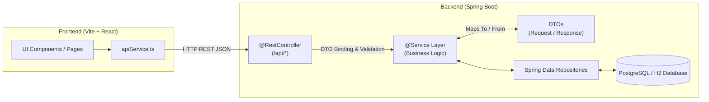

# RMS (Residential Management Software) - DTO, Services & API Mapping Document

This document provides an end-to-end mapping across the **RMS Backend Architecture** (Spring Boot), detailing the interaction between **REST API Endpoints**, **Controllers**, **Service Layer Methods**, **Data Transfer Objects (DTOs)**, **Entities/Database Models**, and **Frontend Service Clients**.

---

## Architecture Overview

---

## 1. Admissions & Resident Onboarding Module

### 1.1 Components & Files
- **Controller:** [AdmissionController.java](file:///c:/Users/Biju%20K/Desktop/rum/rms-backend/src/main/java/com/rms/backend/admissions/controller/AdmissionController.java)
- **Service:** [AdmissionService.java](file:///c:/Users/Biju%20K/Desktop/rum/rms-backend/src/main/java/com/rms/backend/admissions/service/AdmissionService.java)
- **DTOs:**
  - [AdmissionRequestDto.java](file:///c:/Users/Biju%20K/Desktop/rum/rms-backend/src/main/java/com/rms/backend/admissions/dto/AdmissionRequestDto.java)
  - [AdmissionResponseDto.java](file:///c:/Users/Biju%20K/Desktop/rum/rms-backend/src/main/java/com/rms/backend/admissions/dto/AdmissionResponseDto.java)
  - [TenantStayCheckDto.java](file:///c:/Users/Biju%20K/Desktop/rum/rms-backend/src/main/java/com/rms/backend/admissions/dto/TenantStayCheckDto.java)
- **Entities:** [Admission.java](file:///c:/Users/Biju%20K/Desktop/rum/rms-backend/src/main/java/com/rms/backend/admissions/entity/Admission.java), [AdmissionStatus.java](file:///c:/Users/Biju%20K/Desktop/rum/rms-backend/src/main/java/com/rms/backend/admissions/entity/AdmissionStatus.java)
- **Frontend Client:** [apiService.ts](file:///c:/Users/Biju%20K/Desktop/rum/frontend/src/services/apiService.ts) (`createAdmission`, `confirmAdmission`, `cancelAdmission`, `getAdmissions`, `checkExistingTenant`)

### 1.2 API Mappings
| Method | Endpoint | Query / Path / Header Params | Request DTO / Body | Response DTO / Body | Service Method | Description |
| :--- | :--- | :--- | :--- | :--- | :--- | :--- |
| `POST` | `/api/admissions` | Header: `X-Property-Id` (optional) Query: `propertyId` (optional) | `AdmissionRequestDto` | `AdmissionResponseDto` (201 Created) | `createEnrollment(dto)` | Reserves room bed, creates/links Tenant record, initializes admission in `PENDING` status. |
| `GET` | `/api/admissions/check-existing` | Query: `aadhaarNo`, `mobileNumber` | *None* | `TenantStayCheckDto` (200 OK) | `checkExistingTenant(aadhaar, mobile)` | Checks if resident exists, previous stay history, and active residency guard. |
| `GET` | `/api/admissions` | Header: `X-Property-Id` Query: `propertyId` | *None* | `List<AdmissionResponseDto>` (200 OK) | `getAllAdmissions()` or `getAdmissionsByPropertyId(propId)` | Retrieves all admissions or property-filtered list. |
| `GET` | `/api/admissions/{admissionNumber}` | Path: `admissionNumber` | *None* | `AdmissionResponseDto` (200 OK) | `getAdmissionByNumber(num)` | Fetches single admission record by unique admission code (e.g., `ADM-...`). |
| `PUT` | `/api/admissions/{admissionNumber}/confirm` | Path: `admissionNumber` | *None* | `AdmissionResponseDto` (200 OK) | `confirmAdmission(num)` | Promotes `PENDING` -> `PAID`, increments room occupancy, adjusts reserved count. |
| `DELETE` | `/api/admissions/{admissionNumber}` | Path: `admissionNumber` | *None* | `String` confirmation message (200 OK) | `cancelPendingAdmission(num)` | Cancels pending admission, decrements reserved room capacity, deletes orphan tenant. |

### 1.3 DTO Schema Details
#### `AdmissionRequestDto`
- `tenantUid` (`String`): Optional existing tenant UID
- `name` (`String`, `@NotBlank`): Full resident name
- `aadhaarNo` (`String`): 12-digit Aadhaar number
- `mobileNumber` (`String`, `@NotBlank`): Resident contact number
- `tenantType` (`String`): `Working` or `Student`
- `organizationName` (`String`): Employer / College name
- `parentContact` (`String`): Guardian phone number
- `advancePaid` (`Integer`, `@NotNull`): Security deposit paid
- `standardRent` (`Integer`, `@NotNull`): Monthly room rent agreement
- `roomNo` (`String`, `@NotBlank`): Allocated room number
- `enrollmentDate` (`LocalDate`): Date of onboarding
- `remarks` (`String`): Optional notes
- `propertyId` (`Long`): Target property ID

#### `AdmissionResponseDto`
- `admissionNumber` (`String`), `tenantUid` (`String`), `tenantName` (`String`), `tenantStatus` (`String`)
- `aadhaarNo` (`String`), `mobileNumber` (`String`), `parentContact` (`String`)
- `roomNo` (`String`), `roomRent` (`Integer`), `advancePaid` (`Integer`)
- `advancePaidStatus` (`AdvancePaidStatus`: `PAID` / `PENDING`)
- `status` (`AdmissionStatus`: `PENDING`, `PAID`, `VACATED`, `CANCELLED`)
- `enrollmentDate` (`LocalDate`), `remarks` (`String`), `confirmedOn` (`LocalDateTime`), `vacatedOn` (`LocalDate`), `propertyId` (`Long`)

---

## 2. Billing, Invoices & Payment Ledger Module

### 2.1 Components & Files
- **Controllers:**
  - [InvoiceController.java](file:///c:/Users/Biju%20K/Desktop/rum/rms-backend/src/main/java/com/rms/backend/billing/controller/InvoiceController.java) (`/api/invoices`)
  - [LedgerController.java](file:///c:/Users/Biju%20K/Desktop/rum/rms-backend/src/main/java/com/rms/backend/billing/controller/LedgerController.java) (`/api/ledger`)
  - [PaymentController.java](file:///c:/Users/Biju%20K/Desktop/rum/rms-backend/src/main/java/com/rms/backend/billing/controller/PaymentController.java) (`/api/payments`)
- **Service:** [BillingService.java](file:///c:/Users/Biju%20K/Desktop/rum/rms-backend/src/main/java/com/rms/backend/billing/service/BillingService.java)
- **DTOs:**
  - [InvoiceRequestDto.java](file:///c:/Users/Biju%20K/Desktop/rum/rms-backend/src/main/java/com/rms/backend/billing/dto/InvoiceRequestDto.java)
  - [InvoiceResponseDto.java](file:///c:/Users/Biju%20K/Desktop/rum/rms-backend/src/main/java/com/rms/backend/billing/dto/InvoiceResponseDto.java)
  - [CycleGenerationRequestDto.java](file:///c:/Users/Biju%20K/Desktop/rum/rms-backend/src/main/java/com/rms/backend/billing/dto/CycleGenerationRequestDto.java)
  - [CycleGenerationResultDto.java](file:///c:/Users/Biju%20K/Desktop/rum/rms-backend/src/main/java/com/rms/backend/billing/dto/CycleGenerationResultDto.java)
  - [RecordPaymentDto.java](file:///c:/Users/Biju%20K/Desktop/rum/rms-backend/src/main/java/com/rms/backend/billing/dto/RecordPaymentDto.java)
  - [PaymentRequestDto.java](file:///c:/Users/Biju%20K/Desktop/rum/rms-backend/src/main/java/com/rms/backend/billing/dto/PaymentRequestDto.java)
  - [PaymentResponseDto.java](file:///c:/Users/Biju%20K/Desktop/rum/rms-backend/src/main/java/com/rms/backend/billing/dto/PaymentResponseDto.java)
  - [LedgerTransactionRequestDto.java](file:///c:/Users/Biju%20K/Desktop/rum/rms-backend/src/main/java/com/rms/backend/billing/dto/LedgerTransactionRequestDto.java)
  - [LedgerTransactionResponseDto.java](file:///c:/Users/Biju%20K/Desktop/rum/rms-backend/src/main/java/com/rms/backend/billing/dto/LedgerTransactionResponseDto.java)
- **Entities:** [Invoice.java](file:///c:/Users/Biju%20K/Desktop/rum/rms-backend/src/main/java/com/rms/backend/billing/entity/Invoice.java), [Payment.java](file:///c:/Users/Biju%20K/Desktop/rum/rms-backend/src/main/java/com/rms/backend/billing/entity/Payment.java), [LedgerTransaction.java](file:///c:/Users/Biju%20K/Desktop/rum/rms-backend/src/main/java/com/rms/backend/billing/entity/LedgerTransaction.java)

### 2.2 Invoices API Mapping (`/api/invoices`)
| Method | Endpoint | Query / Path / Header Params | Request DTO | Response DTO | Service Method | Description |
| :--- | :--- | :--- | :--- | :--- | :--- | :--- |
| `GET` | `/api/invoices` | Query: `monthYear`, `status` Header/Query: `propertyId` | *None* | `List<InvoiceResponseDto>` (200 OK) | `getAllInvoices(monthYear, status, propId)` | Lists rent invoices with filters. |
| `GET` | `/api/invoices/{id}` | Path: `id` | *None* | `InvoiceResponseDto` (200 OK) | `getInvoiceById(id)` | Fetches invoice by ID. |
| `POST` | `/api/invoices` | Header/Query: `propertyId` | `InvoiceRequestDto` | `InvoiceResponseDto` (201 Created) | `createInvoice(dto)` | Manual single invoice generation for tenant. |
| `POST` | `/api/invoices/generate-cycle` | Header/Query: `propertyId` | `CycleGenerationRequestDto` | `CycleGenerationResultDto` (200 OK) | `generateCycleInvoices(dto)` | Batch generates monthly rent cycle invoices for all active residents. |
| `POST` | `/api/invoices/{id}/pay` | Path: `id` | `RecordPaymentDto` | `InvoiceResponseDto` (200 OK) | `recordPayment(id, dto)` | Records full or partial settlement against an invoice. |

### 2.3 Payments API Mapping (`/api/payments`)
| Method | Endpoint | Query / Path / Header Params | Request DTO | Response DTO | Service Method | Description |
| :--- | :--- | :--- | :--- | :--- | :--- | :--- |
| `POST` | `/api/payments` | Header/Query: `propertyId` | `PaymentRequestDto` | `PaymentResponseDto` (201 Created) | `recordPaymentAuthoritative(dto)` | Idempotent payment recording with ledger sync and partial/full invoice reconciliation. |
| `GET` | `/api/payments` | Query: `invoiceId`, `tenantUid` Header/Query: `propertyId` | *None* | `List<PaymentResponseDto>` (200 OK) | `getAllPayments(propId, uid, invoiceId)` | Retrieves payment records with filters. |
| `GET` | `/api/payments/{id}` | Path: `id` | *None* | `PaymentResponseDto` (200 OK) | `getPaymentById(id)` | Retrieves payment by ID. |
| `GET` | `/api/payments/invoice/{invoiceId}` | Path: `invoiceId` | *None* | `List<PaymentResponseDto>` (200 OK) | `getPaymentsByInvoiceId(id)` | Lists all payments settled against a given invoice. |

### 2.4 Ledger API Mapping (`/api/ledger`)
| Method | Endpoint | Query / Path / Header Params | Request DTO | Response DTO | Service Method | Description |
| :--- | :--- | :--- | :--- | :--- | :--- | :--- |
| `GET` | `/api/ledger` | Query: `type` (`CREDIT`/`DEBIT`) Header/Query: `propertyId` | *None* | `List<LedgerTransactionResponseDto>` (200 OK) | `getAllTransactions(type, propId)` | Full accounting transaction ledger history. |
| `GET` | `/api/ledger/balance` | Header/Query: `propertyId` | *None* | `Map<String, Long>` (200 OK) | `getLatestRunningBalance(propId)` | Current net cash balance for property/system. |
| `POST` | `/api/ledger` | Header/Query: `propertyId` | `LedgerTransactionRequestDto` | `LedgerTransactionResponseDto` (201 Created) | `recordCustomTransaction(dto)` | Records manual debit/credit expense or vendor payout. |
| `GET` | `/api/ledger/tenant/{tenantUid}` | Path: `tenantUid` | *None* | `List<LedgerTransactionResponseDto>` (200 OK) | `getTransactionsByTenant(uid)` | Tenant ledger statement. |
| `GET` | `/api/ledger/invoice/{invoiceId}` | Path: `invoiceId` | *None* | `List<LedgerTransactionResponseDto>` (200 OK) | `getTransactionsByInvoice(id)` | Ledger entries bound to an invoice. |

---

## 3. Properties & Multi-Property Architecture

### 3.1 Components & Files
- **Controller:** [PropertyController.java](file:///c:/Users/Biju%20K/Desktop/rum/rms-backend/src/main/java/com/rms/backend/properties/controller/PropertyController.java)
- **Service:** [PropertyService.java](file:///c:/Users/Biju%20K/Desktop/rum/rms-backend/src/main/java/com/rms/backend/properties/service/PropertyService.java), [PropertyTtlScheduler.java](file:///c:/Users/Biju%20K/Desktop/rum/rms-backend/src/main/java/com/rms/backend/properties/service/PropertyTtlScheduler.java)
- **DTOs:**
  - [PropertyRequestDto.java](file:///c:/Users/Biju%20K/Desktop/rum/rms-backend/src/main/java/com/rms/backend/properties/dto/PropertyRequestDto.java)
  - [PropertyResponseDto.java](file:///c:/Users/Biju%20K/Desktop/rum/rms-backend/src/main/java/com/rms/backend/properties/dto/PropertyResponseDto.java)
  - [PropertySoftDeleteRequestDto.java](file:///c:/Users/Biju%20K/Desktop/rum/rms-backend/src/main/java/com/rms/backend/properties/dto/PropertySoftDeleteRequestDto.java)
  - [PropertyArchiveSnapshotDto.java](file:///c:/Users/Biju%20K/Desktop/rum/rms-backend/src/main/java/com/rms/backend/properties/dto/PropertyArchiveSnapshotDto.java)
- **Entities:** [Property.java](file:///c:/Users/Biju%20K/Desktop/rum/rms-backend/src/main/java/com/rms/backend/properties/entity/Property.java), [PropertyArchiveSnapshot.java](file:///c:/Users/Biju%20K/Desktop/rum/rms-backend/src/main/java/com/rms/backend/properties/entity/PropertyArchiveSnapshot.java)
- **Frontend Client:** [apiService.ts](file:///c:/Users/Biju%20K/Desktop/rum/frontend/src/services/apiService.ts) (`getProperties`, `getPropertyById`, `createProperty`, `updateProperty`, `softDeleteProperty`, `restoreProperty`, `getPropertySnapshot`, `deleteProperty`)

### 3.2 API Mappings
| Method | Endpoint | Query / Path Params | Request DTO | Response DTO | Service Method | Description |
| :--- | :--- | :--- | :--- | :--- | :--- | :--- |
| `GET` | `/api/properties` | Query: `includeDeleted` (`false`) | *None* | `List<PropertyResponseDto>` | `getAllProperties(includeDeleted)` | Returns list of properties. |
| `GET` | `/api/properties/archived` | *None* | *None* | `List<PropertyResponseDto>` | `getArchivedProperties()` | Lists soft-deleted properties inside TTL grace period. |
| `GET` | `/api/properties/{id}` | Path: `id` | *None* | `PropertyResponseDto` | `getPropertyById(id)` | Fetches single property metadata. |
| `POST` | `/api/properties` | *None* | `PropertyRequestDto` | `PropertyResponseDto` (201 Created) | `createProperty(dto)` | Registers new building/property. |
| `PUT` | `/api/properties/{id}` | Path: `id` | `PropertyRequestDto` | `PropertyResponseDto` | `updateProperty(id, dto)` | Updates existing property details. |
| `POST` | `/api/properties/{id}/soft-delete` | Path: `id` | `PropertySoftDeleteRequestDto` | `PropertyResponseDto` | `softDeleteProperty(id, dto)` | Decommissions property with confirmation name, admin PIN, TTL window (30d), and audit JSON snapshot. |
| `POST` | `/api/properties/{id}/restore` | Path: `id` | *None* | `PropertyResponseDto` | `restoreProperty(id)` | Restores soft-deleted property back to active status. |
| `GET` | `/api/properties/{id}/snapshot` | Path: `id` | *None* | `PropertyArchiveSnapshotDto` | `getArchivedSnapshot(id)` | Fetches immutable JSON snapshot generated during decommissioning. |
| `DELETE` | `/api/properties/{id}` | Path: `id` | *None* | `String` (200 OK) | `deleteProperty(id)` | Hard deletes property if zero rooms/tenants. |

---

## 4. Rooms & Inventory Management Module

### 4.1 Components & Files
- **Controller:** [RoomController.java](file:///c:/Users/Biju%20K/Desktop/rum/rms-backend/src/main/java/com/rms/backend/rooms/controller/RoomController.java)
- **Service:** [RoomService.java](file:///c:/Users/Biju%20K/Desktop/rum/rms-backend/src/main/java/com/rms/backend/rooms/service/RoomService.java)
- **DTOs:**
  - [RoomRequestDto.java](file:///c:/Users/Biju%20K/Desktop/rum/rms-backend/src/main/java/com/rms/backend/rooms/dto/RoomRequestDto.java)
- **Entities:** [Room.java](file:///c:/Users/Biju%20K/Desktop/rum/rms-backend/src/main/java/com/rms/backend/rooms/entity/Room.java)
- **Frontend Client:** [apiService.ts](file:///c:/Users/Biju%20K/Desktop/rum/frontend/src/services/apiService.ts) (`getRooms`, `getRoomByRoomNo`, `createRoom`, `updateRoom`, `deleteRoom`)

### 4.2 API Mappings
| Method | Endpoint | Query / Path / Header Params | Request DTO | Response Entity | Service Method | Description |
| :--- | :--- | :--- | :--- | :--- | :--- | :--- |
| `POST` | `/api/rooms` | Header/Query: `propertyId` | `RoomRequestDto` | `Room` (201 Created) | `createRoom(dto)` | Adds room to inventory with floor, capacity, and default monthly rent. |
| `GET` | `/api/rooms` | Header/Query: `propertyId` | *None* | `List<Room>` (200 OK) | `getAllRooms()` or `getRoomsByPropertyId(propId)` | Fetches room list with dynamic capacity calculation. |
| `GET` | `/api/rooms/{roomNo}` | Path: `roomNo` | *None* | `Room` (200 OK) | `getRoomByRoomNo(roomNo)` | Fetches single room details. |
| `PUT` | `/api/rooms/{roomNo}` | Path: `roomNo` | `RoomRequestDto` | `Room` (200 OK) | `updateRoom(roomNo, dto)` | Updates room parameters. |
| `DELETE` | `/api/rooms/{roomNo}` | Path: `roomNo` | *None* | `String` (200 OK) | `deleteRoom(roomNo)` | Deletes room from property inventory. |

---

## 5. Tenants Management Module

### 5.1 Components & Files
- **Controller:** [TenantController.java](file:///c:/Users/Biju%20K/Desktop/rum/rms-backend/src/main/java/com/rms/backend/tenants/controller/TenantController.java)
- **Service:** [TenantService.java](file:///c:/Users/Biju%20K/Desktop/rum/rms-backend/src/main/java/com/rms/backend/tenants/service/TenantService.java)
- **DTOs:**
  - [TenantRequestDto.java](file:///c:/Users/Biju%20K/Desktop/rum/rms-backend/src/main/java/com/rms/backend/tenants/dto/TenantRequestDto.java)
- **Entities:** [Tenant.java](file:///c:/Users/Biju%20K/Desktop/rum/rms-backend/src/main/java/com/rms/backend/tenants/entity/Tenant.java), [AdvancePaidStatus.java](file:///c:/Users/Biju%20K/Desktop/rum/rms-backend/src/main/java/com/rms/backend/tenants/entity/AdvancePaidStatus.java)
- **Frontend Client:** [apiService.ts](file:///c:/Users/Biju%20K/Desktop/rum/frontend/src/services/apiService.ts) (`getTenants`, `getTenantByUid`, `getTenantsByRoom`, `addTenant`, `updateTenant`, `deleteTenant`, `verifyTenantAdvance`)

### 5.2 API Mappings
| Method | Endpoint | Query / Path / Header Params | Request DTO | Response Entity | Service Method | Description |
| :--- | :--- | :--- | :--- | :--- | :--- | :--- |
| `POST` | `/api/tenants` | Header/Query: `propertyId` | `TenantRequestDto` | `Tenant` (201 Created) | `createTenant(dto)` | Direct tenant creation / registration. |
| `GET` | `/api/tenants` | Header/Query: `propertyId` | *None* | `List<Tenant>` (200 OK) | `getAllTenants()` or `getTenantsByPropertyId(propId)` | Lists all active residents. |
| `GET` | `/api/tenants/{uid}` | Path: `uid` | *None* | `Tenant` (200 OK) | `getTenantByUid(uid)` | Retrieves single tenant profile by UID. |
| `GET` | `/api/tenants/room/{roomNo}` | Path: `roomNo` | *None* | `List<Tenant>` (200 OK) | `getTenantsByRoomNo(roomNo)` | Fetches roommates in specified room. |
| `PUT` | `/api/tenants/{uid}` | Path: `uid` | `TenantRequestDto` | `Tenant` (200 OK) | `updateTenant(uid, dto)` | Updates resident details. |
| `DELETE` | `/api/tenants/{uid}` | Path: `uid` | *None* | `String` (200 OK) | `deleteTenant(uid)` | Deletes tenant record. |
| `PUT` | `/api/tenants/{uid}/verify-advance` | Path: `uid` Body: `Map<String, Integer>` | `{"amount": ...}` (optional) | `Tenant` (200 OK) | `verifyAdvancePayment(uid, amount)` | Marks advance status as `PAID` and verifies security deposit. |

---

## 6. Vacate Requests & Departure Settlements Module

### 6.1 Components & Files
- **Controller:** [VacateRequestController.java](file:///c:/Users/Biju%20K/Desktop/rum/rms-backend/src/main/java/com/rms/backend/vacate/controller/VacateRequestController.java)
- **Service:** [VacateRequestService.java](file:///c:/Users/Biju%20K/Desktop/rum/rms-backend/src/main/java/com/rms/backend/vacate/service/VacateRequestService.java)
- **DTOs:**
  - [VacateRequestDto.java](file:///c:/Users/Biju%20K/Desktop/rum/rms-backend/src/main/java/com/rms/backend/vacate/dto/VacateRequestDto.java)
  - [VacateResponseDto.java](file:///c:/Users/Biju%20K/Desktop/rum/rms-backend/src/main/java/com/rms/backend/vacate/dto/VacateResponseDto.java)
  - [VacateChargeUpdateDto.java](file:///c:/Users/Biju%20K/Desktop/rum/rms-backend/src/main/java/com/rms/backend/vacate/dto/VacateChargeUpdateDto.java)
- **Entities:** [VacateRequest.java](file:///c:/Users/Biju%20K/Desktop/rum/rms-backend/src/main/java/com/rms/backend/vacate/entity/VacateRequest.java), [VacateStatus.java](file:///c:/Users/Biju%20K/Desktop/rum/rms-backend/src/main/java/com/rms/backend/vacate/entity/VacateStatus.java)
- **Frontend Client:** [apiService.ts](file:///c:/Users/Biju%20K/Desktop/rum/frontend/src/services/apiService.ts) (`getVacateRequests`, `submitVacateRequest`, `approveVacateRequest`, `rejectVacateRequest`, `updateVacateCharges`, `completeVacateRequest`)

### 6.2 API Mappings
| Method | Endpoint | Query / Path Params | Request DTO | Response DTO | Service Method | Description |
| :--- | :--- | :--- | :--- | :--- | :--- | :--- |
| `POST` | `/api/vacate-requests` | *None* | `VacateRequestDto` | `VacateResponseDto` (201 Created) | `submitVacateRequest(dto)` | Submits vacate notice, computes 30-day notice rules and prorated deductions. |
| `GET` | `/api/vacate-requests` | Query: `status`, `propertyId` | *None* | `List<VacateResponseDto>` (200 OK) | `getAllVacateRequests(status, propId)` | Fetches vacate requests filtered by status / property. |
| `GET` | `/api/vacate-requests/{id}` | Path: `id` | *None* | `VacateResponseDto` (200 OK) | `getVacateRequestById(id)` | Fetches specific vacate notice and financial calculations. |
| `PUT` | `/api/vacate-requests/{id}/approve` | Path: `id` | *None* | `VacateResponseDto` (200 OK) | `approveVacateRequest(id)` | Manager approval: locks in expected leaving date and schedule. |
| `PUT` | `/api/vacate-requests/{id}/reject` | Path: `id` Body: `{"reason": "..."}` | `Map<String, String>` | `VacateResponseDto` (200 OK) | `rejectVacateRequest(id, reason)` | Rejects vacate request with reason. |
| `PUT` | `/api/vacate-requests/{id}/charges` | Path: `id` | `VacateChargeUpdateDto` | `VacateResponseDto` (200 OK) | `updateCharges(id, dto)` | Updates maintenance/breakage charges and recalculates net refundable advance. |
| `PUT` | `/api/vacate-requests/{id}/complete` | Path: `id` | *None* | `VacateResponseDto` (200 OK) | `completeVacate(id)` | Final departure: Frees room capacity, changes tenant/admission to vacated, logs ledger debit for refund. |

---

## 7. Reports & Portfolio Analytics Module

### 7.1 Components & Files
- **Controller:** [ReportController.java](file:///c:/Users/Biju%20K/Desktop/rum/rms-backend/src/main/java/com/rms/backend/reports/controller/ReportController.java)
- **Service:** [ReportService.java](file:///c:/Users/Biju%20K/Desktop/rum/rms-backend/src/main/java/com/rms/backend/reports/service/ReportService.java)
- **DTOs:**
  - [ReportSummaryDto.java](file:///c:/Users/Biju%20K/Desktop/rum/rms-backend/src/main/java/com/rms/backend/reports/dto/ReportSummaryDto.java)
  - [PropertyPerformanceDto.java](file:///c:/Users/Biju%20K/Desktop/rum/rms-backend/src/main/java/com/rms/backend/reports/dto/PropertyPerformanceDto.java)
  - [MonthlyIntakeDto.java](file:///c:/Users/Biju%20K/Desktop/rum/rms-backend/src/main/java/com/rms/backend/reports/dto/MonthlyIntakeDto.java)
  - [DemographicsReportDto.java](file:///c:/Users/Biju%20K/Desktop/rum/rms-backend/src/main/java/com/rms/backend/reports/dto/DemographicsReportDto.java)
- **Frontend Client:** [apiService.ts](file:///c:/Users/Biju%20K/Desktop/rum/frontend/src/services/apiService.ts) (`getReportSummary`, `getPropertyPerformanceReports`, `getMonthlyIntakeReports`, `getDemographicsReports`)

### 7.2 API Mappings
| Method | Endpoint | Query / Header Params | Request Body | Response DTO | Service Method | Description |
| :--- | :--- | :--- | :--- | :--- | :--- | :--- |
| `GET` | `/api/reports/summary` | Header/Query: `propertyId` | *None* | `ReportSummaryDto` | `getSummary(propId)` | Portfolio KPI summary: target vs collected rent, efficiency %, resident counts. |
| `GET` | `/api/reports/property-performance`| Header/Query: `propertyId` | *None* | `List<PropertyPerformanceDto>` | `getPropertyPerformance(propId)`| Property-level metrics, room counts, revenue collection %. |
| `GET` | `/api/reports/monthly-intake` | Query: `year` Header/Query: `propertyId` | *None* | `List<MonthlyIntakeDto>` | `getMonthlyIntake(propId, year)`| Monthly resident intake trend line chart data. |
| `GET` | `/api/reports/demographics` | Header/Query: `propertyId` | *None* | `DemographicsReportDto` | `getDemographics(propId)` | Demographics breakdown: Working vs Students, Hometown breakdown. |

---

## 8. User Management & Administration Module

### 8.1 Components & Files
- **Controller:** [UserController.java](file:///c:/Users/Biju%20K/Desktop/rum/rms-backend/src/main/java/com/rms/backend/users/controller/UserController.java)
- **Service:** [UserService.java](file:///c:/Users/Biju%20K/Desktop/rum/rms-backend/src/main/java/com/rms/backend/users/service/UserService.java)
- **DTOs:**
  - [UserRequestDto.java](file:///c:/Users/Biju%20K/Desktop/rum/rms-backend/src/main/java/com/rms/backend/users/dto/UserRequestDto.java)
  - [UserResponseDto.java](file:///c:/Users/Biju%20K/Desktop/rum/rms-backend/src/main/java/com/rms/backend/users/dto/UserResponseDto.java)
- **Entities:** [User.java](file:///c:/Users/Biju%20K/Desktop/rum/rms-backend/src/main/java/com/rms/backend/users/entity/User.java)
- **Frontend Client:** [apiService.ts](file:///c:/Users/Biju%20K/Desktop/rum/frontend/src/services/apiService.ts) (`getUsers`, `getUserById`, `createUser`, `updateUser`, `deleteUser`)

### 8.2 API Mappings
| Method | Endpoint | Query / Path Params | Request DTO | Response DTO | Service Method | Description |
| :--- | :--- | :--- | :--- | :--- | :--- | :--- |
| `GET` | `/api/users` | *None* | *None* | `List<UserResponseDto>` | `getAllUsers()` | Retrieves list of system users/staff. |
| `GET` | `/api/users/{id}` | Path: `id` | *None* | `UserResponseDto` | `getUserById(id)` | Fetches user details by user ID. |
| `POST` | `/api/users` | *None* | `UserRequestDto` | `UserResponseDto` (201 Created) | `createUser(dto)` | Registers admin, manager, staff, or owner user. |
| `PUT` | `/api/users/{id}` | Path: `id` | `UserRequestDto` | `UserResponseDto` | `updateUser(id, dto)` | Updates user profile or permissions. |
| `DELETE` | `/api/users/{id}` | Path: `id` | *None* | `String` (200 OK) | `deleteUser(id)` | Deletes user from system. |

---

## 9. WhatsApp Notifications & Quick Actions Module

### 9.1 Components & Files
- **Controller:** [WhatsAppController.java](file:///c:/Users/Biju%20K/Desktop/rum/rms-backend/src/main/java/com/rms/backend/notifications/controller/WhatsAppController.java)
- **Service:** [WhatsAppNotificationService.java](file:///c:/Users/Biju%20K/Desktop/rum/rms-backend/src/main/java/com/rms/backend/notifications/service/WhatsAppNotificationService.java)
- **Frontend Client:** [apiService.ts](file:///c:/Users/Biju%20K/Desktop/rum/frontend/src/services/apiService.ts) (`getWhatsAppWelcomePreview`)

### 9.2 API Mappings
| Method | Endpoint | Query / Path Params | Request Body | Response Body | Service Method | Description |
| :--- | :--- | :--- | :--- | :--- | :--- | :--- |
| `GET` | `/api/notifications/whatsapp/welcome-preview/{tenantUid}` | Path: `tenantUid` | *None* | `Map<String, Object>` (200 OK) | `generateWelcomePackage(uid)` | Generates prefilled WhatsApp markdown message, UPI rent pay link, and prefilled vacate notice link. |
| `POST` | `/api/notifications/whatsapp/send-welcome/{tenantUid}` | Path: `tenantUid` | *None* | `Map<String, Object>` (200 OK) | `generateWelcomePackage(uid)` | Triggers WhatsApp welcome delivery or creates WhatsApp deep link. |

---

## 10. Webhooks & System Operations Module

### 10.1 Components & Files
- **Controllers:**
  - [WebhookController.java](file:///c:/Users/Biju%20K/Desktop/rum/rms-backend/src/main/java/com/rms/backend/webhook/controller/WebhookController.java)
  - [SystemCleanupController.java](file:///c:/Users/Biju%20K/Desktop/rum/rms-backend/src/main/java/com/rms/backend/config/SystemCleanupController.java)
- **Frontend Client:** [apiService.ts](file:///c:/Users/Biju%20K/Desktop/rum/frontend/src/services/apiService.ts) (`cleanDatabase`)

### 10.2 API Mappings
| Method | Endpoint | Query / Path Params | Request Body | Response Body | Controller / Service | Description |
| :--- | :--- | :--- | :--- | :--- | :--- | :--- |
| `GET` | `/api/whatsapp/webhook` | Query: `hub.mode`, `hub.verify_token`, `hub.challenge` | *None* | `String` challenge (200 OK) | `verifyWhatsAppWebhook` | WhatsApp Meta Cloud API handshake verification. |
| `POST` | `/api/whatsapp/webhook` | *None* | `Map<String, Object>` payload | `{"status": "EVENT_RECEIVED"}` | `handleWhatsAppWebhook` | Receives inbound WhatsApp message status receipts. |
| `POST` | `/api/webhooks/vacate-request` *(also `/api/vacate/webhook`)* | *None* | `Map<String, Object>` (supports Google Forms, MS Forms, Zapier) | `{"status": "SUCCESS", "requestId": ...}` | `handleVacateRequestWebhook` | Parses external forms, maps to `VacateRequestDto`, and submits to `VacateRequestService`. |
| `POST` | `/api/payments/webhook` *(also `/api/webhooks/payments`)* | *None* | `Map<String, Object>` payment payload | `{"status": "SUCCESS"}` | `handlePaymentWebhook` | Webhook receiver for Razorpay / UPI payment gateway callbacks. |
| `GET` | `/api/webhooks/status` *(also `/api/webhooks/health`)* | *None* | *None* | `{"status": "HEALTHY", ...}` | `getWebhookHealth` | Webhook monitoring and health check endpoint. |
| `POST` | `/api/system/clean-database` | *None* | *None* | `{"success": true, "message": "..."}` | `SystemCleanupController.cleanDatabase` | Wipes all test tables for manual test verification flows. |

---

## 11. Complete Frontend-to-Backend Service Mapping Matrix

| Frontend Client Method (`apiService.ts`) | HTTP Method | Backend URL Path | Header / Parameters Passed | Backend Controller & Service Target |
| :--- | :--- | :--- | :--- | :--- |
| `getTenants(propertyId?)` | `GET` | `/api/tenants` | `X-Property-Id`, `?propertyId=` | [TenantController.getAllTenants](file:///c:/Users/Biju%20K/Desktop/rum/rms-backend/src/main/java/com/rms/backend/tenants/controller/TenantController.java#L42) -> [TenantService](file:///c:/Users/Biju%20K/Desktop/rum/rms-backend/src/main/java/com/rms/backend/tenants/service/TenantService.java) |
| `getTenantByUid(uid)` | `GET` | `/api/tenants/{uid}` | Path: `uid` | [TenantController.getTenantByUid](file:///c:/Users/Biju%20K/Desktop/rum/rms-backend/src/main/java/com/rms/backend/tenants/controller/TenantController.java#L53) |
| `getTenantsByRoom(roomNo)` | `GET` | `/api/tenants/room/{roomNo}`| Path: `roomNo` | [TenantController.getTenantsByRoom](file:///c:/Users/Biju%20K/Desktop/rum/rms-backend/src/main/java/com/rms/backend/tenants/controller/TenantController.java#L58) |
| `addTenant(tenantData)` | `POST` | `/api/tenants` | Body: `TenantRequestDto` | [TenantController.createTenant](file:///c:/Users/Biju%20K/Desktop/rum/rms-backend/src/main/java/com/rms/backend/tenants/controller/TenantController.java#L24) |
| `updateTenant(uid, tenantData)` | `PUT` | `/api/tenants/{uid}` | Body: `TenantRequestDto` | [TenantController.updateTenant](file:///c:/Users/Biju%20K/Desktop/rum/rms-backend/src/main/java/com/rms/backend/tenants/controller/TenantController.java#L63) |
| `deleteTenant(uid)` | `DELETE`| `/api/tenants/{uid}` | Path: `uid` | [TenantController.deleteTenant](file:///c:/Users/Biju%20K/Desktop/rum/rms-backend/src/main/java/com/rms/backend/tenants/controller/TenantController.java#L71) |
| `verifyTenantAdvance(uid, amount)`| `PUT` | `/api/tenants/{uid}/verify-advance` | Body: `{"amount": ...}` | [TenantController.verifyAdvancePayment](file:///c:/Users/Biju%20K/Desktop/rum/rms-backend/src/main/java/com/rms/backend/tenants/controller/TenantController.java#L80) |
| `getAdmissions(propertyId?)` | `GET` | `/api/admissions` | `X-Property-Id`, `?propertyId=` | [AdmissionController.getAllAdmissions](file:///c:/Users/Biju%20K/Desktop/rum/rms-backend/src/main/java/com/rms/backend/admissions/controller/AdmissionController.java#L58) -> [AdmissionService](file:///c:/Users/Biju%20K/Desktop/rum/rms-backend/src/main/java/com/rms/backend/admissions/service/AdmissionService.java) |
| `getAdmissionByNumber(admissionNumber)`| `GET` | `/api/admissions/{num}` | Path: `admissionNumber` | [AdmissionController.getAdmissionByNumber](file:///c:/Users/Biju%20K/Desktop/rum/rms-backend/src/main/java/com/rms/backend/admissions/controller/AdmissionController.java#L73) |
| `createAdmission(admissionData)` | `POST` | `/api/admissions` | Body: `AdmissionRequestDto` | [AdmissionController.createEnrollment](file:///c:/Users/Biju%20K/Desktop/rum/rms-backend/src/main/java/com/rms/backend/admissions/controller/AdmissionController.java#L29) |
| `confirmAdmission(admissionNumber)` | `PUT` | `/api/admissions/{num}/confirm` | Path: `admissionNumber` | [AdmissionController.confirmAdmission](file:///c:/Users/Biju%20K/Desktop/rum/rms-backend/src/main/java/com/rms/backend/admissions/controller/AdmissionController.java#L83) |
| `cancelAdmission(admissionNumber)` | `DELETE`| `/api/admissions/{num}` | Path: `admissionNumber` | [AdmissionController.cancelPendingAdmission](file:///c:/Users/Biju%20K/Desktop/rum/rms-backend/src/main/java/com/rms/backend/admissions/controller/AdmissionController.java#L94) |
| `checkExistingTenant(aadhaar, mobile)`| `GET`| `/api/admissions/check-existing`| Query: `aadhaarNo`, `mobileNumber`| [AdmissionController.checkExistingTenant](file:///c:/Users/Biju%20K/Desktop/rum/rms-backend/src/main/java/com/rms/backend/admissions/controller/AdmissionController.java#L46) |
| `getRooms(propertyId?)` | `GET` | `/api/rooms` | `X-Property-Id`, `?propertyId=` | [RoomController.getAllRooms](file:///c:/Users/Biju%20K/Desktop/rum/rms-backend/src/main/java/com/rms/backend/rooms/controller/RoomController.java#L44) -> [RoomService](file:///c:/Users/Biju%20K/Desktop/rum/rms-backend/src/main/java/com/rms/backend/rooms/service/RoomService.java) |
| `getRoomByRoomNo(roomNo)` | `GET` | `/api/rooms/{roomNo}` | Path: `roomNo` | [RoomController.getRoomByRoomNo](file:///c:/Users/Biju%20K/Desktop/rum/rms-backend/src/main/java/com/rms/backend/rooms/controller/RoomController.java#L55) |
| `createRoom(roomData)` | `POST` | `/api/rooms` | Body: `RoomRequestDto` | [RoomController.createRoom](file:///c:/Users/Biju%20K/Desktop/rum/rms-backend/src/main/java/com/rms/backend/rooms/controller/RoomController.java#L26) |
| `updateRoom(roomNo, roomData)` | `PUT` | `/api/rooms/{roomNo}` | Body: `RoomRequestDto` | [RoomController.updateRoom](file:///c:/Users/Biju%20K/Desktop/rum/rms-backend/src/main/java/com/rms/backend/rooms/controller/RoomController.java#L69) |
| `deleteRoom(roomNo)` | `DELETE`| `/api/rooms/{roomNo}` | Path: `roomNo` | [RoomController.deleteRoom](file:///c:/Users/Biju%20K/Desktop/rum/rms-backend/src/main/java/com/rms/backend/rooms/controller/RoomController.java#L77) |
| `getInvoices(monthYear?, status?, propId?)`| `GET`| `/api/invoices` | Query: `monthYear`, `status`, `propertyId` | [InvoiceController.getAllInvoices](file:///c:/Users/Biju%20K/Desktop/rum/rms-backend/src/main/java/com/rms/backend/billing/controller/InvoiceController.java#L22) -> [BillingService](file:///c:/Users/Biju%20K/Desktop/rum/rms-backend/src/main/java/com/rms/backend/billing/service/BillingService.java) |
| `createInvoice(dto)` | `POST` | `/api/invoices` | Body: `InvoiceRequestDto` | [InvoiceController.createInvoice](file:///c:/Users/Biju%20K/Desktop/rum/rms-backend/src/main/java/com/rms/backend/billing/controller/InvoiceController.java#L41) |
| `generateCycleInvoices(monthYear, dueDate, propId?)`| `POST`| `/api/invoices/generate-cycle`| Body: `CycleGenerationRequestDto` | [InvoiceController.generateCycleInvoices](file:///c:/Users/Biju%20K/Desktop/rum/rms-backend/src/main/java/com/rms/backend/billing/controller/InvoiceController.java#L54) |
| `recordPayment(invoiceId, paymentData)`| `POST`| `/api/invoices/{id}/pay` | Body: `RecordPaymentDto` | [InvoiceController.recordPayment](file:///c:/Users/Biju%20K/Desktop/rum/rms-backend/src/main/java/com/rms/backend/billing/controller/InvoiceController.java#L67) |
| `createAuthoritativePayment(paymentReq)`| `POST`| `/api/payments` | Body: `PaymentRequestDto` | [PaymentController.recordPayment](file:///c:/Users/Biju%20K/Desktop/rum/rms-backend/src/main/java/com/rms/backend/billing/controller/PaymentController.java#L22) |
| `getPaymentsForInvoice(invoiceId)` | `GET` | `/api/payments/invoice/{invoiceId}`| Path: `invoiceId` | [PaymentController.getPaymentsByInvoiceId](file:///c:/Users/Biju%20K/Desktop/rum/rms-backend/src/main/java/com/rms/backend/billing/controller/PaymentController.java#L52) |
| `getTransactions(type?, propId?)` | `GET` | `/api/ledger` | Query: `type`, `propertyId` | [LedgerController.getAllTransactions](file:///c:/Users/Biju%20K/Desktop/rum/rms-backend/src/main/java/com/rms/backend/billing/controller/LedgerController.java#L24) |
| `getLedgerByTenant(tenantUid)` | `GET` | `/api/ledger/tenant/{tenantUid}`| Path: `tenantUid` | [LedgerController.getTransactionsByTenant](file:///c:/Users/Biju%20K/Desktop/rum/rms-backend/src/main/java/com/rms/backend/billing/controller/LedgerController.java#L60) |
| `getLedgerByInvoice(invoiceId)` | `GET` | `/api/ledger/invoice/{invoiceId}`| Path: `invoiceId` | [LedgerController.getTransactionsByInvoice](file:///c:/Users/Biju%20K/Desktop/rum/rms-backend/src/main/java/com/rms/backend/billing/controller/LedgerController.java#L66) |
| `getLedgerBalance(propertyId?)` | `GET` | `/api/ledger/balance` | Header/Query: `propertyId` | [LedgerController.getRunningBalance](file:///c:/Users/Biju%20K/Desktop/rum/rms-backend/src/main/java/com/rms/backend/billing/controller/LedgerController.java#L36) |
| `recordTransaction(dto)` | `POST` | `/api/ledger` | Body: `LedgerTransactionRequestDto` | [LedgerController.recordTransaction](file:///c:/Users/Biju%20K/Desktop/rum/rms-backend/src/main/java/com/rms/backend/billing/controller/LedgerController.java#L47) |
| `getProperties(includeDeleted?)` | `GET` | `/api/properties` | Query: `includeDeleted` | [PropertyController.getAllProperties](file:///c:/Users/Biju%20K/Desktop/rum/rms-backend/src/main/java/com/rms/backend/properties/controller/PropertyController.java#L26) -> [PropertyService](file:///c:/Users/Biju%20K/Desktop/rum/rms-backend/src/main/java/com/rms/backend/properties/service/PropertyService.java) |
| `getArchivedProperties()` | `GET` | `/api/properties/archived` | *None* | [PropertyController.getArchivedProperties](file:///c:/Users/Biju%20K/Desktop/rum/rms-backend/src/main/java/com/rms/backend/properties/controller/PropertyController.java#L35) |
| `getPropertyById(id)` | `GET` | `/api/properties/{id}` | Path: `id` | [PropertyController.getPropertyById](file:///c:/Users/Biju%20K/Desktop/rum/rms-backend/src/main/java/com/rms/backend/properties/controller/PropertyController.java#L40) |
| `createProperty(propertyData)` | `POST` | `/api/properties` | Body: `PropertyRequestDto` | [PropertyController.createProperty](file:///c:/Users/Biju%20K/Desktop/rum/rms-backend/src/main/java/com/rms/backend/properties/controller/PropertyController.java#L45) |
| `updateProperty(id, propertyData)` | `PUT` | `/api/properties/{id}` | Body: `PropertyRequestDto` | [PropertyController.updateProperty](file:///c:/Users/Biju%20K/Desktop/rum/rms-backend/src/main/java/com/rms/backend/properties/controller/PropertyController.java#L51) |
| `softDeleteProperty(id, data)` | `POST` | `/api/properties/{id}/soft-delete`| Body: `PropertySoftDeleteRequestDto`| [PropertyController.softDeleteProperty](file:///c:/Users/Biju%20K/Desktop/rum/rms-backend/src/main/java/com/rms/backend/properties/controller/PropertyController.java#L62) |
| `restoreProperty(id)` | `POST` | `/api/properties/{id}/restore` | Path: `id` | [PropertyController.restoreProperty](file:///c:/Users/Biju%20K/Desktop/rum/rms-backend/src/main/java/com/rms/backend/properties/controller/PropertyController.java#L73) |
| `getPropertySnapshot(propertyId)` | `GET` | `/api/properties/{id}/snapshot` | Path: `id` | [PropertyController.getPropertySnapshot](file:///c:/Users/Biju%20K/Desktop/rum/rms-backend/src/main/java/com/rms/backend/properties/controller/PropertyController.java#L82) |
| `deleteProperty(id)` | `DELETE`| `/api/properties/{id}` | Path: `id` | [PropertyController.deleteProperty](file:///c:/Users/Biju%20K/Desktop/rum/rms-backend/src/main/java/com/rms/backend/properties/controller/PropertyController.java#L87) |
| `getUsers()` | `GET` | `/api/users` | *None* | [UserController.getAllUsers](file:///c:/Users/Biju%20K/Desktop/rum/rms-backend/src/main/java/com/rms/backend/users/controller/UserController.java#L24) -> [UserService](file:///c:/Users/Biju%20K/Desktop/rum/rms-backend/src/main/java/com/rms/backend/users/service/UserService.java) |
| `getUserById(id)` | `GET` | `/api/users/{id}` | Path: `id` | [UserController.getUserById](file:///c:/Users/Biju%20K/Desktop/rum/rms-backend/src/main/java/com/rms/backend/users/controller/UserController.java#L29) |
| `createUser(userData)` | `POST` | `/api/users` | Body: `UserRequestDto` | [UserController.createUser](file:///c:/Users/Biju%20K/Desktop/rum/rms-backend/src/main/java/com/rms/backend/users/controller/UserController.java#L34) |
| `updateUser(id, userData)` | `PUT` | `/api/users/{id}` | Body: `UserRequestDto` | [UserController.updateUser](file:///c:/Users/Biju%20K/Desktop/rum/rms-backend/src/main/java/com/rms/backend/users/controller/UserController.java#L40) |
| `deleteUser(id)` | `DELETE`| `/api/users/{id}` | Path: `id` | [UserController.deleteUser](file:///c:/Users/Biju%20K/Desktop/rum/rms-backend/src/main/java/com/rms/backend/users/controller/UserController.java#L48) |
| `getVacateRequests(status?, propId?)`| `GET` | `/api/vacate-requests` | Query: `status`, `propertyId` | [VacateRequestController.getAllVacateRequests](file:///c:/Users/Biju%20K/Desktop/rum/rms-backend/src/main/java/com/rms/backend/vacate/controller/VacateRequestController.java#L30) -> [VacateRequestService](file:///c:/Users/Biju%20K/Desktop/rum/rms-backend/src/main/java/com/rms/backend/vacate/service/VacateRequestService.java) |
| `submitVacateRequest(data)` | `POST` | `/api/vacate-requests` | Body: `VacateRequestDto` | [VacateRequestController.submitVacateRequest](file:///c:/Users/Biju%20K/Desktop/rum/rms-backend/src/main/java/com/rms/backend/vacate/controller/VacateRequestController.java#L24) |
| `approveVacateRequest(id)` | `PUT` | `/api/vacate-requests/{id}/approve`| Path: `id` | [VacateRequestController.approveVacateRequest](file:///c:/Users/Biju%20K/Desktop/rum/rms-backend/src/main/java/com/rms/backend/vacate/controller/VacateRequestController.java#L42) |
| `rejectVacateRequest(id, reason?)` | `PUT` | `/api/vacate-requests/{id}/reject` | Body: `{"reason": ...}` | [VacateRequestController.rejectVacateRequest](file:///c:/Users/Biju%20K/Desktop/rum/rms-backend/src/main/java/com/rms/backend/vacate/controller/VacateRequestController.java#L47) |
| `updateVacateCharges(id, m, b, n)` | `PUT` | `/api/vacate-requests/{id}/charges`| Body: `VacateChargeUpdateDto` | [VacateRequestController.updateCharges](file:///c:/Users/Biju%20K/Desktop/rum/rms-backend/src/main/java/com/rms/backend/vacate/controller/VacateRequestController.java#L55) |
| `completeVacateRequest(id)` | `PUT` | `/api/vacate-requests/{id}/complete`| Path: `id` | [VacateRequestController.completeVacate](file:///c:/Users/Biju%20K/Desktop/rum/rms-backend/src/main/java/com/rms/backend/vacate/controller/VacateRequestController.java#L62) |
| `getReportSummary(propId?)` | `GET` | `/api/reports/summary` | Header/Query: `propertyId` | [ReportController.getSummary](file:///c:/Users/Biju%20K/Desktop/rum/rms-backend/src/main/java/com/rms/backend/reports/controller/ReportController.java#L22) -> [ReportService](file:///c:/Users/Biju%20K/Desktop/rum/rms-backend/src/main/java/com/rms/backend/reports/service/ReportService.java) |
| `getPropertyPerformanceReports(propId?)`| `GET` | `/api/reports/property-performance`| Header/Query: `propertyId` | [ReportController.getPropertyPerformance](file:///c:/Users/Biju%20K/Desktop/rum/rms-backend/src/main/java/com/rms/backend/reports/controller/ReportController.java#L30) |
| `getMonthlyIntakeReports(propId?, y?)` | `GET` | `/api/reports/monthly-intake` | Query: `year`, `propertyId` | [ReportController.getMonthlyIntake](file:///c:/Users/Biju%20K/Desktop/rum/rms-backend/src/main/java/com/rms/backend/reports/controller/ReportController.java#L38) |
| `getDemographicsReports(propId?)` | `GET` | `/api/reports/demographics` | Header/Query: `propertyId` | [ReportController.getDemographics](file:///c:/Users/Biju%20K/Desktop/rum/rms-backend/src/main/java/com/rms/backend/reports/controller/ReportController.java#L47) |
| `getWhatsAppWelcomePreview(tenantUid)`| `GET` | `/api/notifications/whatsapp/welcome-preview/{uid}`| Path: `tenantUid` | [WhatsAppController.getWelcomePreview](file:///c:/Users/Biju%20K/Desktop/rum/rms-backend/src/main/java/com/rms/backend/notifications/controller/WhatsAppController.java#L18) -> [WhatsAppNotificationService](file:///c:/Users/Biju%20K/Desktop/rum/rms-backend/src/main/java/com/rms/backend/notifications/service/WhatsAppNotificationService.java) |
| `cleanDatabase()` | `POST` | `/api/system/clean-database` | *None* | [SystemCleanupController.cleanDatabase](file:///c:/Users/Biju%20K/Desktop/rum/rms-backend/src/main/java/com/rms/backend/config/SystemCleanupController.java#L34) |
